指令

功能手册

V1.7.5

2026.06

# 文档版本

| 版本号 | 修订日期 |
| --- | --- |
| 1.3 | 2025 年 08 月 21 日 |
| 1.4 | 2025 年 08 月 30 日 |
| 1.5 | 2025 年 09 月 18 日 |
| 1.6 | 2025 年 10 月 14 日 |
| 1.7 | 2025 年 10 月 28 日 |
| 1.7.1 | 2025 年 12 月 15 日 |
| 1.7.2 | 2025 年 12 月 30 日 |
| 1.7.3 | 2026 年 01 月 16 日 |
| 1.7.4 | 2026 年 01 月 22 日 |
| 1.7.5 | 2026 年 06 月 06 日 |

## 目录

- 文档版本　I
- 一、SDK 中指令发送机制与系统状态反馈　1
  - 1.RPC 指令发送和 Topic 系统状态获取说明　1
  - 2.RPC 返回值说明和含义　1
  - 3. 指令同步发送说明　2
  - 4. 指令异步发送说明　3
  - 5. 指令独立线程发送说明　4
  - 6.Topic 获取系统状态信息说明　5
- 二、常用变量类型　8
  - 1. load 变量　8
  - 2. jointtarget 关节空间参数　8
  - 3. robottarget 笛卡尔空间参数　9
  - 4. speed 速度参数　9
  - 5. zone 转弯半径　10
  - 6. tool 工具参数　11
  - 7. wobj 基坐标系参数　12
  - 8. 其他变量类型　12
- 三、基础运动指令　13
  - 1.Var 定义变量　13
  - 2.Enable 上使能　14
  - 3.Disable 下使能　15
  - 4.Recover 状态同步　16
  - 5.Start 开始　16
  - 6.Stop 停止　17
  - 7.Pause 暂停　17
  - 8.Sleep 系统休眠等待　18
  - 9.MoveAbsJ 关节运动　18
  - 10.JogJoint 关节点动　19
  - 11.JogCartesian 笛卡尔点动（位置 + 姿态）　20
  - 12.JogC 单步笛卡尔点动　21
  - 13.MoveJ 关节空间运动　22
- 四、常用系统指令　23
  - 1.Clear 错误清理　23
  - 2.SetTool 设置工具　23
  - 3.SetWobj 设置基坐标系　25
  - 4.SetUsingSP 最优规划求解　26
  - 5.SubLoop 多模型控制优化指令　26
  - 6.SetSlaveVirtual 从机虚实状态设置　28
  - 7.SetSystemConf 修改关节参数　29
  - 8.ClbJZero 关节零位标定　30
  - 9.RestoreDefaultJointSoftLimit 恢复默认关节软限位　31
  - 10.SetJointSoftLimit 关节软限位设置　31
  - 11.ReadPdo 读取 Pdo 对象　33
  - 12.ReadSdo 读取 Sdo 对象　34
- 五、在线规划指令　35
  - 1.SpeedJ 在线关节速度控制　35
  - 2.SpeedL 笛卡尔空间在线速度控制　39
  - 3.JogAnyJ 在线关节角度规划　41
  - 4.JogAnyJFast 快速运动模式　45
  - 5.JogAnyC 在线笛卡尔位姿规划　48
  - 6.JogAnyCpos 在线笛卡尔位置规划　49
  - 7.SetEgmOffset 在线偏移控制　50
- 六、高级规划指令　51
  - 1.MoveBlend 笛卡尔空间下轨迹融合 ( 局部 )　51
  - 2.MoveBlendScurve 笛卡尔空间下轨迹融合（匀速）　56
  - 3.MoveBlendOptimalPos 笛卡尔空间下轨迹融合（最大速）　58
  - 4.MoveS 笛卡尔空间下轨迹融合（全程）　60
  - 5.ServoSeries 关节空间下轨迹融合指令　62
  - 6.MoveSeriesToppJ 关节空间下轨迹融合（最大速）　63
- 七、力控指令　64
  - 1. 六维力传感器概述　64
  - 2.ForcePositionHybridControl 笛卡尔空间下力 - 位混合控制　65
  - 3.DragInCST 电流环下机器人拖动控制　68
- 八、IO 模块指令　69
  - 1.GetDI 读取输入电平状态　69
  - 2.SetDO 设置输出电平状态　69
  - 3.DOPulse 输出数字脉冲信号　70
  - 4.AddIO 注册新的 I/O 信号通道　70
- 九、底盘导航指令　71
  - 1. MobileRobotModbusTCPJGBOT 运动指令　71
- 十、干涉区指令　72
  - 1. SetInterferRNG 干涉区建立　72
  - 2. CtrlInterferRNG 干涉区控制　73
# 一、SDK 中指令发送机制与系统状态反馈

## 1.RPC 指令发送和 Topic 系统状态获取说明

| ➢ 通道 | ➢ 端口 | ➢ 协议 | ➢ 方向 | ➢ 用途 |
| --- | --- | --- | --- | --- |
| RPC 指令通道 | 5868 | TCP+JSON | 发指令、收响应 | 向控制器下发运动 / 控制 / 参数指令 |
| Topic 状态通道 | 19091 | ZeroMQ+Protobuf | 控制器发布→客户端订阅 | 只读订阅机器人实时状态数据 |
| 两者互不占用对方资源。典型用法是配合使用：用 RPC 下发控制指令，同时用 Topic 监控机器人实际状态（例如 RPC 异步发送 SpeedL 在线规划，Topic 实时读取关节实际位置做监控或闭环）。  以下 RPC 指令发送和 Topic 系统状态获取只作基础介绍，同步发送、异步发送、独立线程发送区别和接口调用。  详情 RPC 指令发送资料请点击 https://gitee.com/zhenshi-controller-api-data/send_commend_c。  详情 Topic 系统状态获取资料请点击 https://gitee.com/zhenshi-controller-api-data/get_status_c。 |  |  |  |  |

## 2.RPC 返回值说明和含义

| ➢ 返回层级 | 第一层为传输状态 status，是调用发送接口的第一个返回值，主要目的是确认请求是否送达、响应是否正常收到并解析。  第二层是执行结果 return code，是响应 Json 内的字段，为了说明控制器对这条指令的调度与执行结果。 |
| --- | --- |
| ➢ RPC 返回值结构解析 |  |
| send[seq=1]: {Clear} | 发出的指令 {Clear} |
| ********Sync[seq=1]******** | status = 0（传输成功） |
| model size:1 | 机械臂模型数量 |
| subcmd_index:0 | 模型编号（从 0 开始） |
| return_code:0 | 0 代表 {Clear} 不进实时队列 |
| return_message: | 结果描述文本 |

➢ 报错快速判定流程

Status≠0 时，会报 Synchronous request failed! ... Error code: <status>，这时候检查传输 /网络层。

当 Status ＝ 0 时，看响应体 return_code。

return_code 等于 0 或者 1 时，指令运行成功。

return_code 小于 0 时，指令运行失败。

➢ 常见错误码

报错时 return_code 会返回错误码，需要在 return_message中查看报错信息。（下列错误码表只截取一部分）

错误码

含义

排查建议

-501

轴没有使能

检查使能状态

-502

位置指令超过最小值

检查关节限位

-503

位置指令超过最大值

检查关节限位

-504

位置指令一阶不连续

期望速度超限，检查奇异点或减速

-505

位置指令二阶不连续

期望加速度超限，减速或检查奇异点

-506

位置存在跟踪误差

检查负载 / 加速度是否过大，，适当减速

-507

实际速度超过最小值

检查速度指令与限位设置

-508

实际速度超过最大值

将速度指令降至限速范围内

-509

速度指令一阶不连续

平滑速度指令，避免突变

-510

速度存在跟踪误差

检查负载 / 参数，适当降速

-513

运动发生了碰撞

检查碰撞检测设置、轨迹与障碍物

## 3. 指令同步发送说明

➢ 同步发送机制

逐条发送 , 每条指令必须等控制器应答 ( 或超时 ) 后才发下一条 , 调用线程在此期间被阻塞。应答中携带 return_code/subcmd_index/return_message(Python 为 code/message/index), 可直接判断每条指令执行结果。

➢ 语言

➢ 接口

➢ 签名要点

C++

send_rpcsy<RespDemo>(client, cmds, 间隔 ms)

模板参数指定响应类型 , 一般为 RespDemo

Python

send_rpcsy(client, cmds,  sleep_s)

返回全部响应列表

➢ 函数说明

适用场景：

指令之间有严格顺序依赖 ( 如先 {Enable} 后运动 );

需要根据上一条指令的执行结果决定下一步 ;

点到点运动 (MoveAbsJ、MoveS 等 ) 按顺序到位执行。

➢ 例程示例

例 1. 在 C++ 中调用同步发送函数

例 2. 在 Python 中调用同步发送函数

例 1

// 初始化类指令 , 间隔 100ms

send_rpcsy<RespDemo>(client, init_cmds, 100);

// 运动类指令 , 间隔 500ms

send_rpcsy<RespDemo>(client, motion_cmds, 500);

例 2

send_rpcsy(client, init_cmds, sleep_s=0.1)

send_rpcsy(client, motion_cmds, sleep_s=0.5)

## 4. 指令异步发送说明

| ➢ 异步发送机制 | 指令发出后立即继续下一条 , 不阻塞等待应答 ; 控制器应答到达后由底层在回调中通知 ( 超时也会以负值状态触发回调 )。每条消息带自增序列号 seq_id, 回调中可用它对应 " 是哪条指令的返回 "。 |  |
| --- | --- | --- |
| ➢ 语言 | ➢ 接口 | ➢ 签名要点 |
| C++ | send_rpcAsy(client, cmds, 间隔ms) | 结果通过回调返回 , 发送线程不阻塞 |
| Python | send_rpc_async(client, cmds, wait_s) | 支持 response_callback(status, resp_list, seq_id, cmd) |

➢ 函数说明

适用场景：

持续型速度指令 ( 如 SpeedL --last_count=1000), 执行时间长、无需阻塞等待 ;

{JogAnyJ} / {SpeedJ} 等需要高频下发的控制指令 ;

UI 按钮回调、事件驱动逻辑中发指令 , 避免卡住主线程。

➢ 例程示例

例 1. 在 C++ 中调用异步发送函数

例 2. 在 Python 中调用异步发送函数

例 1

// SpeedL 速度运动 + Stop/Start, 异步下发

send_rpcAsy(client, async_cmds,500);

例 2

send_rpc_async(client, async_cmds,wait_s=0.5)

## 5. 指令独立线程发送说明

| ➢ 独立线程发送机制 | 同步发送 send_rpcsy 内部走 CallAwait, 调用线程会阻塞等待控制器应答——运动指令可能要等数秒。如果发送动作发生在 UI 按钮回调、键盘事件、其他工作线程等入口 , 阻塞会卡死主流程。  send_rpc_thread 的作用就是 : 调用方立即返回 , 发送动作在独立线程中完成 , 应答结果通过回调送达。C++ 与 Python 均提供该接口 ,语义一致。 |  |
| --- | --- | --- |
| ➢ 语言 | ➢ 接口 | ➢ 签名要点 |
| C++ | send_rpc_thread(client,cmd,debug,outim_num,response_callback) | 返回 std::future<bool>; 回调 void(int status, const core::Msg& resp, int seq, const std::string& cmd);内部用 std::async 起独立线程 ,走 CallAsyncRaw |
| Python | send_rpc_thread(client,cmd,debug=False,timeout_ms,response_callback=None) | 返回 Future; 回调 callback(status, raw_response, seq_id, cmd); 内部提交到单 worker 线程池 rpc-send,走 CallAsyncRaw |

➢ 函数说明

1. cmd: 单条指令字符串 ( 非列表 );

2. debug: 是否打印发送与返回信息 , 默认 false;

3. outim_num / timeout_ms: 该条指令应答超时 , 默认 10000ms;

4. response_callback: 可选回调 ,C++ 签名 void(int status, const core::Msg& resp, int seq, const std::string& cmd),Python 签名 callback(status, raw_response, seq_id, cmd);

5. 返回值 (future) 只表示指令是否成功提交到底层发送接口 , 执行结果在回调中获取 ; 回调拿到的是原始应答报文 , 需自行解析 JSON;

➢ 例程示例

例 1. 在 C++ 中调用独立线程发送函数（节选）

例 2. 在 Python 中调用独立线程发送函数（节选）

例 1

// 在独立线程中发送 SetEgmOffset 进行在线偏移

auto setegmoffset_future = send_rpc_thread(client, setegmoffset_cmd,true);

例 2

setegmoffset_future = send_rpc_thread(client, setegmoffset_cmd, debug=True)

## 6.Topic 获取系统状态信息说明

| ➢ Topic 订阅机制 | 控制器持续发布两类数据 :RT( 实时 , 默认 250Hz)——关节位置 /速度 / 力矩、末端位姿、错误码、六维力、系统运行状态 ;NRT( 非实时 , 默认 2Hz)——关节限位、工具 / 工件 / 负载、IO、示教点、从站、子系统、接口、系统初始化状态。  数据详情请见 https://gitee.com/zhenshi-controller-api-data/get_status_c。  读取前先用 hasRtData() / hasNrtData() 判断首帧数据是否已到达。  提供两种读取方式 :Direct( 自由函数 , 内部自动取快照 , 适合读少量字段 ) 和 Snapshot( 先取一致性快照再逐字段读 , 适合批量读取 ), 所有读取操作线程安全。 |  |
| --- | --- | --- |
| ➢ 语言 | ➢ 接口 | ➢ 签名要点 |
| C++ | start_subscriber(ip) + 自由函数 getJointPosition(m, j) 等 / 快照 | 只传发布者 IP, 端口固定 19091; 快照对象用 rt.valid() 判有效 ,rt.jointPosition(m,j)、rt.isSystemRunning() |

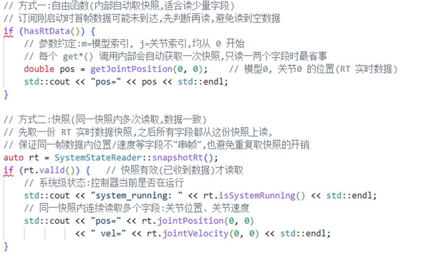

SystemStateReader::snapshotRt()

等逐字段读取

Python

get_topic_module() + topic.start_subscriber(ip) + get_joint_position(m, j) 等 /SystemStateReader.snapshot_rt()

platform_loader 自动加载匹配平台的动态库 ;has_rt_data() /has_nrt_data() 判断数据到达 ; 参数 m 为模型索引、j 为关节索引 , 均从 0 开始

➢ 函数说明

适用场景 :

高频读取关节位置 / 速度 / 力矩、末端位姿 , 用于闭环监控、轨迹记录 ;

读取系统运行状态、模型 / 关节错误码 , 用于故障诊断与安全联锁 ;

读取子系统、接口、IO 等低频配置 (NRT);

与 RPC 配合使用——RPC 下发指令、Topic 回读状态 , 实现控制与监控分离。

➢ 例程示例

例 1. 在 C++ 中订阅系统状态（节选）

例 2. 在 Python 中订阅系统状态（节选）

例 1

例 2

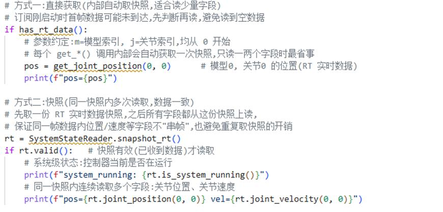

# 二、常用变量类型

## 1. load 变量

➢ 变量说明

该结构体包含一个刚体在某一个坐标系下的十个描述质量分布特性的 double 型参数：mass 质量，cogx 质心在 x 方向的偏移量，cogy 质心在 y 方向的偏移量，cogz 质心在 z 方向的偏移量，i 表示惯性张量矩阵参数（ ixx,iyy,izz,ixy,ixz,iyz ）。（质量单位：千克 kg；偏移量单位：千克 * 米 kg·m ）

对于机器人来说，该参数可用于描述机器人末端负载参数特性，坐标系一般默认为末端法兰盘坐标系。

➢ 使用示例

Var --name=piece --type=load --value={mass, mass*cogx, mass*cogy,mass*cogz,0,0,0,0,0,0}

## 2. jointtarget 关节空间参数

➢ 变量说明

jointtarget 有 2 种调用方式，一种为 Var 声明后，运动指令即可通过 --jointtarget_var 调用，一种为运动指令添加 --jointtarget_value={J0,J1,J2,J3,J4,J5,J6,J7,J8,J9} 参数调用。

该结构体共有十个 double 型参数（ J0~J9 ），存储机器人目标关节角度（单位是弧度）和外部轴位置（单位是米或弧度）。会从该十个数依次匹配目标关节角度与外部轴位置。目标关节角度与外部轴总数不得超过十个。

➢ 使用示例

Var --type=jointtarget --name=j1 --value={0.0,-1.57,-1.57,-1.57,1.57,0.0,0,0,0,0}   //Var 声明后，运动指令即可通过 --jointtarget_var 调用

Var --type=jointtarget --name=j1 --value={0.0,-0.57,-1.57,-1.57,1.57,0.0,0,0,0,0} --is_override=1  // 可以覆写已定义的点位

Var --type=jointtarget --name=j0 --value={10,15,1,18,60,4,0,0,0,0} --degree_unit=1  // 定义j0 的 value 值为角度制

## 3. robottarget 笛卡尔空间参数

➢ 变量说明

robottarget 有 2 种调用方式，一种方式为 Var 声明后，运动指令即可通过 --robottarget_var 调用，一种方式为运动指令中添加 --robottarget_value={x,y,z,qi,qj,qk,qw} 参数调用。

该结构体储笛卡尔空间的目标位置及姿态（ double ），包含 x, y, z, qi, qj, qk, qw，适用于JogAnyC，MoveBlend，MoveBlendScurve 指令，位置单位为米。（ qi, qj, qk, qw 是四元数四个分量）

➢ 使用示例

Var --name=p1 --type=robottarget --value={x,y,z,qi,qj,qk,qw}

## 4. speed 速度参数

➢ 变量说明

speed 有 2 种调用方式，一种是运动指令中加 --speed=v10，一种是运动指令中加 --speed_value=0.1，（建议在笛卡尔空间运动指令中使用）单位为 m/s。

该结构体包含 5 个 double 型成员变量，per 关节速度百分比，tcp 线速度（ m/s ），eri 空间旋转速度（ rad/s ），exj_r 外部轴角速度（ rad/s ），exj_l 外部轴线速度（ m/s ），适用于 MoveAbsJ，JogJoint，JogC 等指令。

➢ 使用示例

Var --name=v1 --type=speed --value={per,tcp,eri,exj_r,exj_l}

在 xml 文件的 model-Variable 节点下，有一些已定义好的 speed 结构体，例如v100={0.1,0.1,0.34906585,0,0}，其中第一个 0.1 表示关节 max_vel 的 10%。

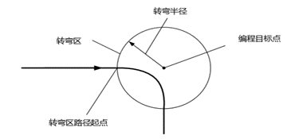

## 5. zone 转弯半径

➢ 变量说明

该结构体变量用于定义某一个运动如何结束或者说定义两条运动轨迹之间转弯区的大小。该结构体包含两个 double 型变量，distance 为笛卡尔空间的转弯区大小，单位是米；percent为转弯区所占运动时间的百分比，适用于 MoveBlend、JogAnyC、JogAnyCpos 等运动指令直接的融合。

转弯区的距离大小不能超过前后两条待融合路径长度的一半，如果超过，系统会自动将转弯区长度缩小到前后两条路径中长度较小的一半；转弯区的时间不能超过前后两条待融合运动时间的一半，如果超过，系统会自动将转弯区时间缩小到前后两条路径中时间较小的一半。使用转弯区可以避免机器人频繁启停，显著减少节拍时间。

➢ 使用示例

Var --name=z100 --type=zone --value={dis,per}

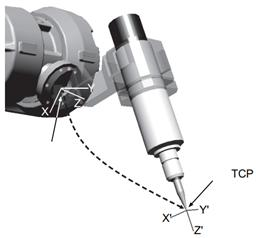

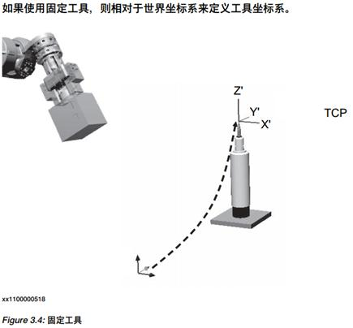

## 6. tool 工具参数

➢ 变量说明

tool 记录工具参数，包含机器人所用工具的位置、姿态。位置是相对于机器人末端法兰盘坐标系的 x,y,z 三个方向的偏移量，单位为米，姿态是工具坐标系相对于法兰坐标系的姿态偏移量，用四元数表示。--value={x,y,z,qi,qj,qk,qw}

➢ 使用示例

Var --name=tool --type=tool --value={x,y,z,qi,qj,qk,qw}

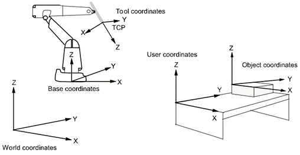

## 7. wobj 基坐标系参数

➢ 变量说明

该结构体所有运动指令中使用的位置都是在工件坐标系下定义的（如果没有指定工件坐标系，则默认在世界坐标系下定义，世界坐标系可以被看做是 wobj0 ）。

➢ 使用示例

Var --name=wobj2 --type=wobj --value ={x,y,z,qi,qj,qk,qw}

## 8. 其他变量类型

| ➢ 变量类型 | Number | ➢ 变量说明 | 双精度浮点数 |
| --- | --- | --- | --- |
| ➢ 变量类型 | Matrix | ➢ 变量说明 | 数值型数组 |
| ➢ 变量类型 | String | ➢ 变量说明 | 字符串 |

# 三、基础运动指令

## 1.Var 定义变量

| ➢ 指令用法 | 定义变量 |  |
| --- | --- | --- |
| ➢ 指令参数 | 数据类型 | 含义 |
| --name | String | 变量名 |
| --type | String | 变量类型 |
| --value | Number/Matrix | 变量值 |
| --degree_unit | Number | 输入类型 |
| --clear | None | 清除所有已定义变量 |
| --is_override | Number | 是否启用覆写 |
| ➢ 指令说明 |  |  |
| 1 ）当其他指令参数需要调用这些变量时，可通过 --type_var 的方式调用。  2 ）--type 支持的变量类型有 Number,Matrix,String,speed,robottarget,zone,jointtarget,tool,wobj,load。  3 ）--value 可以是单个值，也可以是用大括号包含的矩阵。  4 ）var 为临时变量，重启后不保存，使用方式为 _var, 如：--jointtarget_var、--robottarget_var、--speed_var 等等（见运动指令中的使用示例）。  5 ）在定义关节变量（ jointtarget ）时，可以通过 --degree_unit=1 来选择 value 单位为角度，--degree_unit=0 则 value 单位为弧度。  6 ）变量名称不支持纯数字，需要以英文字母开头。  7 ）--is_override=1 时，Var 定义变量可以覆写已存在的点位，--is_override=0 时关闭。 |  |  |
| ➢ 指令示例 |  |  |
| Var --name=pi --type=Number --value=3.14  Var --name=pe --type=Matrix --value={0.3,0.2,0.1,0,0,0}  Var --name=z2 --type=zone --value={0.1,0.1}  Var --type=Matrix --name=m0 --value={1,1,1,0.1,0.1,0.1}  Var --type=robottarget --name=pq --value={0,0,0,0,0,0,1}  Var --type=jointtarget --name=j0 --value={0.1,-0.1,-0.1,-0.1,0.1,0.4,0,0,0,0} --degree_unit=1  Var --type=tool --name=toolPP --value={0.1,0,0,0,0,0,1}  Var --type=load --name=load1 --value={0,0,0,0,0,0,0,0,0,0}  Var --clear  // 清除所有 var 变量 |  |  |

## 2.Enable 上使能

| ➢ 指令用法 | 使能所有的伺服电机设备或者某一个伺服电机设备 |  |
| --- | --- | --- |
| ➢ 指令参数 | 数据类型 | 含义 |
| --limit_time | Number | 容许的最大等待周期数  当在该时间内未能使能成功，则系统会抛出异常，错误等级为 ERROR。 |
| --all  --motion_id | Number | --all 表示对所有电机使能；--motion_id=i 时表示对第 i+1 个电机使能。 |
| ➢ 指令说明 |  |  |
| ➢ 指令示例 |  |  |
| 例 1  Enable：相当于 Enable --all --limit_time=5000，或 Enable -a --limit_time  // 功能为使能全部电机，使能超时时间为 5000 周期数。   例 2  Var --type=load --name=load1 --value={0,0,0,0,0,0,0,0,0,0}  Enable --motion_id=0 --limit_time=4000 // 功能为使能第一个电机，使能超时时间为 4000周期数。 |  |  |

## 3.Disable 下使能

| ➢ 指令用法 | 下使能所有的伺服电机设备或者某一个伺服电机设备 |  |
| --- | --- | --- |
| ➢ 指令参数 | 数据类型 | 含义 |
| --limit_time | Number | 容许的最大等待时间周期数  当在该时间内未能下使能成功，则系统会抛出异常，错误等级为 ERROR。 |
| --all  --motion_id | Number | --all 表示对所有电机下使能；--motion_id=i 时表示对第 i+1 个电机下使能。 |
| ➢ 指令说明 |  |  |
| ➢ 指令示例 |  |  |
| 例 1  Disable：相当于 Disable --all --limit_time=5000，或 Disable -a --limit_time=5000  // 功能为下使能全部电机，下使能超时时间为 5000 周期数。  例 2  Var --type=load --name=load1 --value={0,0,0,0,0,0,0,0,0,0}  Disable --motion_id=0 --limit_time=4000  // 功能为下使能第一个电机，下使能超时时间为 4000 周期数。 |  |  |

## 4.Recover 状态同步

| ➢ 指令用法 | 同步模型状态与实际被控对象的状态 |  |
| --- | --- | --- |
| ➢ 指令参数 | 无 |  |
| ➢ 指令说明 | 从 CST 模式切换到 CSP 模式前，要使用该指令，用于同步实际模型状态，不然无法通过 Show 指令获取机器人当前实际状态。 |  |
| ➢ 指令示例 |  |  |
| 无 |  |  |

## 5.Start 开始

| ➢ 指令用法 | 将被暂停或停止的运动重新启动 |  |
| --- | --- | --- |
| ➢ 指令参数 | 数据类型 | 含义 |
| --last_count | Number | 运动重启到位所需的控制周期数 |
| ➢ 指令说明 |  |  |
| ➢ 指令示例 |  |  |
| 例 1  Start：相当于 Start --last_count=10  // 花费 10 个控制周期数完成运动重启。  Start --last_count=5  // 花费 5 个控制周期数完成运动重启。 |  |  |

## 6.Stop 停止

| ➢ 指令用法 | 停止运动，并跳出该指令。该指令后面的缓冲指令均不执行。当设备处于 Stop 状态，需要先执行 Start 指令，才会接收和执行其他指令。 |  |
| --- | --- | --- |
| ➢ 指令参数 | 数据类型 | 含义 |
| --last_count | Number | 完全停止运动所需的控制周期数 |
| ➢ 指令说明 | 1. 可用于紧急停止机器人当前运动，可使用默认参数。  2. Stop 与 Start 一一对应。  3. 多条指令阻塞调用时，一个 Stop 只能终止一条指令。 |  |
| ➢ 指令示例 |  |  |
| 例 1  Stop：相当于 Stop --last_count=10  // 花费 10 个控制周期数完全停止运动。  Stop --last_count=5  // 花费 5 个控制周期数完全停止运动。 |  |  |

## 7.Pause 暂停

| ➢ 指令用法 | 暂停运动，不跳出该指令。Start 后该指令可继续执行。该指令后面的缓冲指令会继续执行。 |  |
| --- | --- | --- |
| ➢ 指令参数 | 数据类型 | 含义 |
| --last_count | Number | 完全停止运动所需的控制周期数 |
| ➢ 指令说明 |  |  |
| ➢ 指令示例 |  |  |
| 例 1  Pause：相当于 Pause --last_count=10  // 花费 10 个控制周期数完全暂停运动。  Pause --last_count=5  // 花费 5 个控制周期数完全暂停运动。 |  |  |

## 8.Sleep 系统休眠等待

| ➢ 指令用法 | 程序执行时，系统线程休眠，暂停后续指令执行，等待指定时长后继续运行下一条指令。休眠期间系统不占用 CPU 资源，仅挂起等待。 |  |
| --- | --- | --- |
| ➢ 指令参数 | 数据类型 | 含义 |
| --count | Number | 休眠周期数 |
| ➢ 指令说明 |  |  |
| ➢ 指令示例 |  |  |
| 例 1  Sleep --count=1000   // 延时等待指令 |  |  |

## 9.MoveAbsJ 关节运动

| ➢ 指令用法 | 关节空间运动 |  |
| --- | --- | --- |
| ➢ 指令参数 | 数据类型 | 含义 |
| --jointtarget/  --jointtarget_var/  --jointtarget_value/ | jointtarget | 目标关节角度变量（详情见 jointtarget 关节空间参数） |
| --speed/  --speed_var | speed | 速度参数（详情见 speed 速度参数） |
| --zone/--zone_var | zone | 轨迹融合变量 |
| ➢ 指令说明 | 无 |  |
| ➢ 指令示例 |  |  |

例 1

Var --type=jointtarget --name=j0 --value={0.1,0.2,0.3,0.4,0.5,0,0,0,0,0}

MoveAbsJ --jointtarget_var=j0  // 其他均取默认值

例 2

MoveAbsJ --jointtarget_value={0.1,0.2,0.3,0.4,0.5,0,0,0,0,0} --speed=v30

## 10.JogJoint 关节点动

| ➢ 指令用法 | 关节空间指定轴 Jog 运动 |  |
| --- | --- | --- |
| ➢ 指令参数 | 数据类型 | 含义 |
| --increase_count | Number | 持续周期数 |
| --speed  --speed_var | speed | 速度参数，单位为 rad/s  （详情见 speed 速度参数） |
| --motion_id | Number | 关节索引，--motion_id=i 时表示是第 i+1 个电机 |
| --direction | Number | 运动方向：1- 正方向运动，-1- 负方向运动 |
| --margin | Number | 关节正负方向最大限位余量（ rad ） |
| ➢ 指令说明 |  |  |
| 默认参数：--stop  --margin 表示关节正负方向最大限位余量，比如关节 1 正负限位为 170 度，正负方向最大到达±169.5 度，默认值为 0.01rad。 |  |  |
| ➢ 指令示例 |  |  |
| 例 1  JogJoint --speed=v100 --motion_id=0 --increase_count=50 --direction=1  JogJoint --speed=v100 --motion_id=1 --increase_count=50 --direction=-1  JogJoint --speed=v100 --motion_id=5 --increase_count=50 --direction=1 |  |  |

## 11.JogCartesian 笛卡尔点动（位置 + 姿态）

| ➢ 指令用法 | 笛卡尔空间连续运动 |  |
| --- | --- | --- |
| ➢ 指令参数 | 数据类型 | 含义 |
| --increase_count | Number | 持续周期数 |
| --moving_type | Number | 笛卡尔运动方式 0~5（ X、Y、Z 平动、旋转） |
| --speed  --speed_value  --speed_var | speed | 六维笛卡尔速度：x/y/z 方向平动，单位 m/s，rx/ry/rz 方向转动，单位 rad/s。  （详情见 speed 速度参数） |
| --direction | Number | 运动方向：1- 正方向运动，-1- 负方向运动 |
| --coordinate | Number | 运动的参考坐标系：  0- 绝对世界坐标系，1- 工具坐标系 |
| ➢ 指令说明 |  |  |
| ➢ 指令示例 |  |  |
| 例 1  JogCartesian --moving_type=0 --direction=1 --speed=v100 --coordinate=0 --increase_count=50  JogCartesian --moving_type=1 --direction=-1 --speed_value=0.1 --coordinate=0 --increase_count=50   JogCartesian --moving_type=2 --direction=1 --speed=v100 --coordinate=0 --increase_count=50   例 2  JogCartesian --moving_type=3 --direction=1 --speed=v100 --coordinate=0 --increase_count=50  JogCartesian --moving_type=4 --direction=1 --speed_value=0.1 --coordinate=0 --increase_count=50   JogCartesian --moving_type=5 --direction=1 --speed=v100 --coordinate=0 --increase_count=50 |  |  |

## 12.JogC 单步笛卡尔点动

| ➢ 指令用法 | 笛卡尔空间单步运动 |  |
| --- | --- | --- |
| ➢ 指令参数 | 数据类型 | 含义 |
| --speed/  --speed_value | speed | 六维笛卡尔速度：x/y/z 方向平动，单位 m/s，rx/ry/rz 方向转动，单位 rad/s。 |
| --motion_type | Number | 笛卡尔运动方式 0~5（ X、Y、Z 平动、旋转） |
| --direction | Number | 运动方向，1 表示正方向，-1 表示负方向 |
| --step | Number | 点动步长，指单次点动操作中，执行机构的最小移动量，x/y/z 方向平动，单位 m，rx/ry/rz 方向转动，单位 rad。（必须为正数） |
| --coordinate | Number | 运动的参考坐标系：  0- 绝对世界坐标系，1- 工具坐标系 |
| ➢ 指令说明 |  |  |
| ➢ 指令示例 |  |  |
| 例 1  JogC --motion_type=0 --speed_value=0.02 --direction=1 --coordinate=0   JogC --motion_type=1 --speed=v100 --direction=1 --coordinate=0 --step=0.1  JogC --motion_type=2 --speed_value=0.02 --direction=1 --coordinate=0  例 2  JogC --motion_type=3 --speed_value=0.02 --direction=1 --coordinate=0 --step=0.1  JogC --motion_type=4 --speed=v50 --direction=1 --coordinate=0  JogC --motion_type=5 --speed_value=0.02 --direction=1 --coordinate=0 |  |  |

## 13.MoveJ 关节空间运动

| ➢ 指令用法 | 关节空间运动 |  |
| --- | --- | --- |
| ➢ 指令参数 | 数据类型 | 含义 |
| --speed/  --speed_var/  --speed_value/ | speed | 速度变量（详情见 speed 速度参数） |
| --robottarget/  --robottarget_var/ --robottarget_value | robottarget | 目标点位置变量（详情见 robottarget 笛卡尔空间参数） |
| --tool/  --tool_var | tool | 工具坐标系位姿信息 |
| --wobj/  --wobj_var | wobj | 基坐标系位姿信息 |
| --iter_num | Number | 迭代次数（默认值：5000 ） |
| ➢ 指令说明 |  |  |
| 该该指令接收笛卡尔空间的目标位姿（ robotarget ），通过逆运动学迭代计算（由 iter_num 控制迭代上限，默认 5000 次，以保证求解精度）得出各关节目标角度。随后，底层在关节空间内对各关节进行插补，各轴同时转动实现末端移动。 |  |  |
| ➢ 指令示例 | 例 1 机械臂运动轨迹顺序为：A → B → C |  |
| 例 1  MoveJ --robottarget_value={-0.546,-0.221,0.515,0.499,0.5,-0.499,0.5} --speed=v50   MoveJ --robottarget_value={-0.366,-0.221,0.515,0.499,0.5,-0.499,0.5} --speed=v50   MoveJ --robottarget_value={-0.366,-0.221,0.409,0.499,0.5,-0.499,0.5} --speed=v50 |  |  |

# 四、常用系统指令

## 1.Clear 错误清理

| ➢ 指令用法 | 清除异常等级为 ERROR 的异常，恢复系统到正常状态 |
| --- | --- |
| ➢ 指令参数 | 无 |
| ➢ 指令说明 | 用于报错等级为 ERROR 时，清除错误信息，并不会清除变量 Var。 |
| ➢ 指令示例 | 无 |

## 2.SetTool 设置工具

| ➢ 指令用法 | 设置末端工具坐标系 |  |
| --- | --- | --- |
| ➢ 指令参数 | 数据类型 | 含义 |
| --tool_var | tool | 工具坐标系位姿信息 |
| ➢ 指令说明 |  |  |
| ➢ 指令示例 |  |  |
| 例 1  Var --type=tool --name=tool_new --value={0.161739,0,0.185219,0,0.57358,0,0.81915}  SetTool --tool_var=tool_new  注意：在末端法兰盘坐标系下，期望的新 tool 的坐标 |  |  |

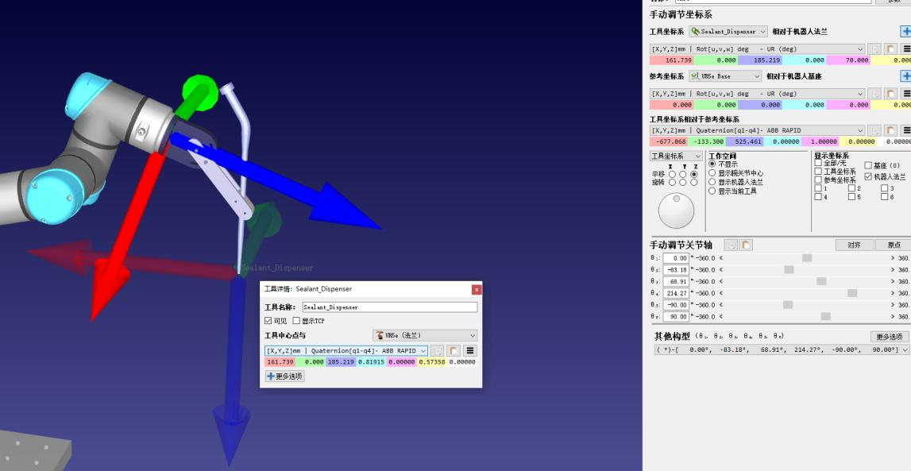

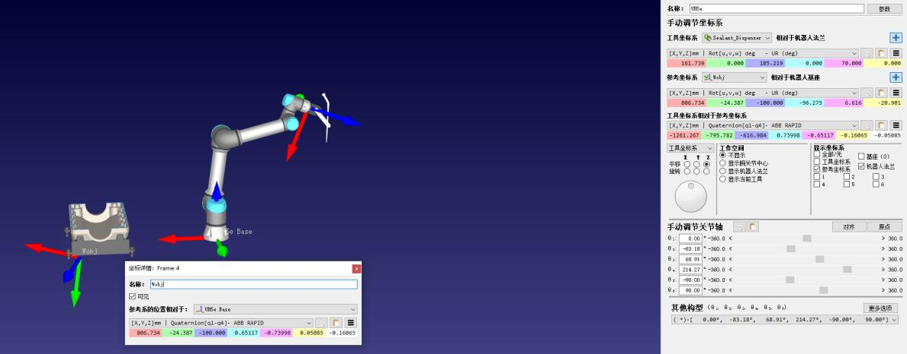

## 3.SetWobj 设置基坐标系

| ➢ 指令用法 | 设置基坐标系 |  |
| --- | --- | --- |
| ➢ 指令参数 | 数据类型 | 含义 |
| --wobj_var | wobj | 基坐标系位姿信息 |
| ➢ 指令说明 |  |  |
| ➢ 指令示例 |  |  |
| 例 1  Var --type=wobj --name=wobj_new --value={0.392367,-0.024387,0,0,0,0,1}  SetWobj --wobj_var=wobj_new  注意：在 base 坐标系下，期望的新 wobj 的坐标 |  |  |

## 4.SetUsingSP 最优规划求解

| ➢ 指令用法 | 最优规划求解模式 |  |
| --- | --- | --- |
| ➢ 指令参数 | 数据类型 | 含义 |
| --state | String | 开关 |
| ➢ 指令说明 |  |  |
| ➢ 指令示例 |  |  |
| 例 1  SetUsingSP --state=on// 打开最优求解器  SetUsingSP --state=off// 关闭最优求解器 |  |  |

## 5.SubLoop 多模型控制优化指令

| ➢ 指令用法 | 多模型控制优化 |  |
| --- | --- | --- |
| ➢ 指令参数 | 数据类型 | 含义 |
| --exec | String | 当前模型需要执行的指令 |
| --immediate | String | 指令立即执行 |
| ➢ 指令说明 |  |  |
| 该指令在多模型场景下，对系统控制指令的处理机制进行了优化，具体如下：  在多模型场景中，如果不使用 SubLoop，而是直接发送组合指令，例如：{MoveAbsJ\|\|MoveAbsJ}，那么系统只有在整条大指令全部执行完成并返回结果之后，才能继续发送下一条指令。也就是说，在这种方式下，必须等两个模型对应的小指令都执行结束，系统才会进入下一步。  当两个小指令的执行耗时接近时，这种方式问题不大；但如果两条小指令的执行时间差异较大，系统就会被执行较慢的那条指令拖住，导致整体返回时间变长，影响后续指令的下发效率，这显然不够合理。  因此，引入了 SubLoop 机制来解决这一问题。 |  |  |

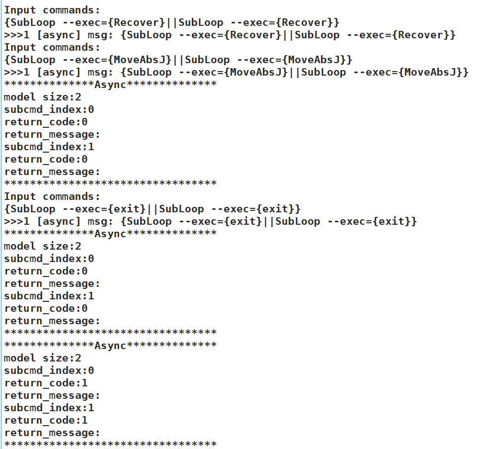

在使用 SubLoop 后，如 {SubLoop --exec={MoveAbsJ}||SubLoop --exec={MoveAbsJ}}，只要后端收到了 SubLoop 指令，会将大指令中的小指令放到对应模型的待执行队列中，然后立刻响应一个返回值（第一条指令除外）。后端会有对应的线程去处理待执行队列中的指令。与此同时，后续到来的新指令不会丢失，而是会先进入待执行队列；等当前对应的小指令执行完成后，再从队列中依次取出并继续执行。

这样一来，系统在多模型场景下的指令处理会更加高效，也能避免因个别慢指令而阻塞整体流程。

如图所示：

➢ 注意事项

1 ）在使用 SubLoop 时，通常发送的第一条 SubLoop 指令是不会立刻有返回值的，后续指令都会有返回值，第一条指令的返回值是在 SubLoop 退出的时候，这时会返回 SubLoop 的第一条指令的返回值。

2 ）第一条指令必须是异步指令且超时时间必须长于接下来执行所有指令时间的总和，后续的指令可以是同步也可以是异步。

3 ）使用 SubLoop 时，若处在多模型中只能发送多模型指令，不可对其中一个模型发指

令，另一个不发。

4 ）默认情况下，immediate 为 false。

➢ 指令示例

# 双模型指令，对第一个模型发送 Recover 指令，第二个模型不发送指令（错误示例）

SubLoop --exec={Recover}||NotRunExecute

# 双模型指令，对两个模型发送指令（正确示例）

SubLoop --exec={Move1}||SubLoop --exec={Move2}

# immediate 置为 true，则系统会放弃对当前指令的处理，处理这个指令

SubLoop --exec={getInfo} --immediate=true

## 6.SetSlaveVirtual 从机虚实状态设置

| ➢ 指令用法 | 设置机械臂状态从实机切换到虚化 |  |
| --- | --- | --- |
| ➢ 指令参数 | 数据类型 | 含义 |
| --is_virtual | String | 是否虚化 |
| ➢ 指令说明 |  |  |
| 可以在测试不熟悉的指令之前通过该指令设置机械臂为虚化状态，以免发生意外 |  |  |
| ➢ 指令示例 |  |  |
| 例 1  SetSlaveVirtual –is_virtual=1  // 设置机械臂状态为虚化  SetSlaveVirtual –is_virtual=0  // 设置机械臂状态为实机 |  |  |

## 7.SetSystemConf 修改关节参数

| ➢ 指令用法 | 按关节修改限位、速度、加速度和换算参数 |  |
| --- | --- | --- |
| ➢ 指令参数 | 数据类型 | 含义 |
| --motion_id | Number | 要修改的关节编号，从 0 开始；0 表示第 1 个关节 |
| --name | String | 可修改的参数名：max_pos、min_pos、max_vel、min_vel、max_acc、min_acc、pos_factor、vel_factor |
| --vaule | Number | 写入的新数值，正负限位通常分别填写正值和负值 |
| ➢ 指令说明 |  |  |
| 参数说明：  1.max_pos/min_pos 是限制关节的最大和最小运动范围，其中区分直线关节和旋转关节，直线关节的单位是 m，旋转关节的单位是 rad。  2.max_vel/ min_vel 是限制关节最大和最小运动速度，其中区分直线关节和旋转关节，直线关节的单位是 m/s，旋转关节的单位是 rad/s。  3.max_acc/min_acc 是指限制关节最大和最小加速度，其中区分直线关节和旋转关节，直线关节的单位是 m/s2，旋转关节的单位是 rad/s2。  4.pos_factor 是指位置换算，用于建立驱动器编码器计数值（ count ）与关节端位置之间的换算关系。该参数以减速器输出端（关节侧）为基准，其中根据编码器安装位置不同，该参数计算方式也不同。单位为 m 或 rad。  要是编码器安装于电机端，编码器采集的是电机轴转角信息。由于关节输出端与电机之间存在减速器，因此编码器测量值需要经过减速比换算后，才能得到关节实际运动量。  编码器安装于减速器输出端（关节端），编码器直接采集关节输出轴转角。由于编码器已经位于减速器之后，因此测量结果已经包含减速器传动关系，无需再乘减速比。  5.vel_factor 是指速度换算，将控制系统中的目标速度（已折算到减速器输出端）转换为驱动器需要的速度值。单位为 m/s 或 rad/s，当单位对应时（ m↔m/s,rad↔rad/s ），通常vel_factor=pos_factor。  注意事项：  1. 修改前记录原值。修改后必须保存，并用低速短距离点动复核。  2.max_pos 必须大于 min_pos，max_vel/max_acc 与对应 min 值的方向要一致；换算系数错误会造成显示位置、实际位移或速度不一致。  3. 配置建议：首先确定关节类型（直线或旋转），设置软限位范围 max_pos/min_pos。接着计算并配置 pos_factor 和 vel_factor，然后设置 max_vel / min_vel 与 max_acc / min_acc（注意单位转换）。最后进行运动验证 |  |  |

➢ 指令示例

例 1：修改直线关节位置限位，对应正向 37.5 mm、负向 -37.5 mm。实际值必须按机械行程填写。

例 2：修改直线关节速度限制，这里直接填写关节最大速度，单位为 m/s，不是速度百分比。

例 3：修改直线关节加速度限制。

例 4：修改直线关节位置和速度换算。

例 1

{SetSystemConf --motion_id=0 --name=max_pos --value=0.0375}

{SetSystemConf --motion_id=0 --name=min_pos --value=-0.0375}

例 2

{SetSystemConf --motion_id=0 --name=max_vel --value=0.000797}

{SetSystemConf --motion_id=0 --name=min_vel --value=-0.000797}

例 3

{SetSystemConf --motion_id=0 --name=max_acc --value=0.0114}

{SetSystemConf --motion_id=0 --name=min_acc --value=-0.0114}

例 4

{SetSystemConf --motion_id=0 --name=pos_factor --value=428032000}

{SetSystemConf --motion_id=0 --name=vel_factor --value=428032000}

## 8.ClbJZero 关节零位标定

| ➢ 指令用法 | 把指定关节的当前位置标定为 new_pos。一般用于机械零位已经确认后，重新设置关节零位。 |  |
| --- | --- | --- |
| ➢ 指令参数 | 数据类型 | 含义 |
| --motion_id | Number | 需要标定的关节编号，从 0 开始；0 表示第 1 个关节。 |
| --new_pos | Number | 把当前机械位置写成的关节位置值；0.0 表示当前位置设为零位。 |
| ➢ 指令说明 |  |  |
| --new_pos 区分直线关节和旋转关节，直线关节单位为 m，旋转关节单位为 rad。  执行方法：先把指定关节移动到已确认的机械零位并完全停止，再直接输入上面的指令；完成后重新读取位置，并进行低速正、负方向点动检查。  注意事项：  1. 执行前核对实际关节，避免标定错轴。  2. 该指令会改变关节零位基准。只有在机械零位已确认、机构停止且现场安全时才能执行；执行后必须低速检查运动方向、位置限位和回零结果。 |  |  |
| ➢ 指令示例 | 例 1. 第 1 个关节当前位置设置为零位 |  |
| 例 1  {ClbJZero --motion_id=0 --new_pos=0.0} |  |  |

## 9.RestoreDefaultJointSoftLimit 恢复默认关节软限位

| ➢ 指令用法 | 恢复正负限位设置，以程序启动时 xml 文件配置的正负  限位为准 |  |
| --- | --- | --- |
| ➢ 指令参数 | 数据类型 | 含义 |
| --motion_id | String | 关节索引，--motion_id=i 时表示是第 i+1 个电机 |
| ➢ 指令说明 |  |  |
| 1 ）该指令仅搭配 SetJointSoftLimit 关节软限位设置 使用  2 ）该指令将限位恢复至保存在 xml 文件中的位置，若限位存在改动，请及时保存 |  |  |
| ➢ 指令示例 |  |  |
| // 恢复 J3 关节的默认限位  {RestoreDefaultJointSoftLimit --motion_id=2} |  |  |

## 10.SetJointSoftLimit 关节软限位设置

| ➢ 指令用法 | 基于当前位置，加一段正负限位作为该关节的软限位 |  |
| --- | --- | --- |
| ➢ 指令参数 | 数据类型 | 含义 |
| --motion_id | String | 关节索引，--motion_id=i 时表示是第 i+1 个电机 |
| --positive_limit_increment | String | 正限位 |
| --negative_limit_increment | String | 负限位 |
| ➢ 指令说明 |  |  |
| 1 ）设置限位时，请确保机器人当前轴位置在设置区间内  2 ）旋转关节轴限位采用弧度制；若为直线关节，单位为 m  3 ）正限位所设值需大于负限位，正限位和负限位所设值不能相同  4 ）若设置正负限位为近似值，则关节暂停运动 |  |  |

5 ）恢复软限位设置使用 RestoreDefaultJointSoftLimit 恢复默认关节软限位指令

➢ 指令示例

// 设置 J1 轴，正限位为 90°，负限位为 0°

{SetJointSoftLimit --motion_id=0 --positive_limit_increment=1.57 --negative_limit_increment=0}

// 设置 J2 轴，负限位为 -45°，正限位为 45°

{SetJointSoftLimit --motion_id=1 --negative_limit_increment=-0.78 --positive_limit_increment=0.78}

// 当为导轨时，单位为 m

// 设置 J1 轴导轨，正限位为 0.1m，负限位为 -0.1m

{SetJointSoftLimit --motion_id=0 --positive_limit_increment=0.1 --negative_limit_increment=-0.1}

## 11.ReadPdo 读取 Pdo 对象

| ➢ 指令用法 | 用于从网络中的一个从站（ Slave ） 设备读取已配置的 PDO（ Process Data Object，过程数据对象） 的数值 |  |
| --- | --- | --- |
| ➢ 指令参数 | 数据类型 | 含义 |
| --slave_id | Number | 从站编号，从 0 开始，0 通常代表网络中的第一个从站设备 |
| --index | Number(Hex) | 十六进制，对象字典主索引，对象字典中某个特定对象（ Object ） 的主索引号 |
| --sub_index | Number(Hex) | 十六进制，对象字典子索引，当主索引指向的对象是复合数据类型时，用子索引来指定具体要访问其中的哪一个子项 |
| --size | Number | 字节长度，指定要读取的数据的大小。 |
| --slave_id_all_pdo | Number | 从站编号，从 0 开始，可以展示从站编号下所有的pdo，使用详情见指令示例 2 |
| --interval | Number | 读取间隔 |
| --loop | Number | 循环次数，指定命令执行的总次数 |
| ➢ 指令说明 |  |  |
| ➢ 指令示例 | 例 1. 通过 PDO 通道，从 6 号从站设备中，单次读取其当前的“实际位置值”  例 2. ReadPdo 配合 --slave_id_all_pdo 使用 , 展示 0 号从站设备中所有的 pdo 值 |  |
| 例 1  {ReadPdo --slave_id=6 --index=0x6064 --sub_index=0x00 --size=32 --interval=1 --loop=1}  例 2  {ReadPdo --slave_id_all_pdo=0 --interval=1 --loop=1} |  |  |

## 12.ReadSdo 读取 Sdo 对象

| ➢ 指令用法 | 向网络中的指定从站设备，发送一个读取请求，以获取其某个特定SDO（ Service Data Object，服务数据对象）参数的当前值 |  |
| --- | --- | --- |
| ➢ 指令参数 | 数据类型 | 含义 |
| --slave_id | Number | 从站编号，从 0 开始，0 通常代表网络中的第一个从站设备 |
| --index | Number(Hex) | 十六进制，对象字典主索引，对象字典中某个特定对象（ Object ） 的主索引号 |
| --sub_index | Number(Hex) | 十六进制，对象字典子索引，当主索引指向的对象是复合数据类型时，用子索引来指定具体要访问其中的哪一个子项 |
| --size | Number | 字节长度，指定要读取的数据的大小。 |
| --loop | Number | 循环次数，指定命令执行的总次数。 |
| ➢ 指令说明 |  |  |
| ➢ 指令示例 | 例 1. 通过 SDO 通道，向网络中 ID 为 5 的从站设备，读取一次它的“实际位置” |  |
| 例 1  ReadSdo --slave_id=5 --index=0x6064 --sub_index=0x00 --size=32 --loop=1 |  |  |

# 五、在线规划指令

## 1.SpeedJ 在线关节速度控制

| ➢ 指令用法 | 关节空间下，SpeedJ 用于执行关节速度控制指令。用户可输入期望的关节速度，控制器根据设定的最大加速度（ acc ）、减速度（ dec ）和加加速度（ jerk ）进行速度插值规划，使关节速度平滑变化。  该指令属于在线速度控制指令，可周期性发送新的速度指令以实时更新关节运动状态。  当在持续时间内未收到新的 SpeedJ 指令时，系统会自动减速停止，使机械臂保持静止。 |  |
| --- | --- | --- |
| ➢ 指令参数 | 数据类型 | 含义 |
| --vel | Number | 目标关节速度（ rad/s ） |
| --acc | Number | 关节最大加速度（ rad/s2） |
| --dec | Number | 关节最大减速度（ rad/s2） |
| --jerk | Number | 关节最大加加速度（ rad/s3） |
| --last_count | Number | 持续周期数 |
| --stop | 无 | 停止当前速度控制 |
| ➢ 指令说明 | 1.vel 参数：目标关节速度，支持多关节数组输入，例如 {v1，v2，v3，v4，v5，v6} 表示各个关节目标速度；{v} 表示各个关节目标速度均为 v。  2.last_count 参数：持续周期数。  该指令的持续时间，当然要是在持续时间内发送下一条该指令，则直接执行下一条指令，因为这是实时更新的。  3.stop 参数：SpeedJ --stop 表明立即退出在线规划状态并减速停止运动。 |  |
| ➢ 指令示例 | 例 1：在 --last_count 内均可以实时更新关节速度，当最后一个指令发出后在last_count 内没有接受新 SpeedJ 指令则退出在线规划状态减速停止运动。  例 2：就算在 --last_count 内，发出该 SpeedJ --stop 指令后会立刻退出在线规划状态并停止运动。  例 3：通过 SpeedJ 的 SDK 异步发送指令，并且用 Topic 的 SDK 采集实时的机械臂各个关节数据 |  |
| 例 1  SpeedJ --vel={0.03,0,0,0,0,0,0} --acc={1} --dec={1} --jerk={1} --last_count=1000  SpeedJ --vel={0.4,0,0,0,0,0,0} --acc={1} --dec={1} --jerk={1} --last_count=1000   SpeedJ --vel={0.1,0,0,0,0,0,0} --acc={1} --dec={1} --jerk={1} --last_count=1000 |  |  |
| 例 2  SpeedJ --vel={0.2}   // 表明每个关节速度均为 0.2  SpeedJ –stop |  |  |
| 例 3  关节以启动角为零点，做 ±0.05 rad 最大幅值、2 Hz 最大频率的正弦位置摆动。控制频率 62.5 Hz（发送间隔 16 ms ）  由于 SpeedJ 只能控制关节速度，加速度，持续时间。因此需要速度对时间求积分才能得出 |  |  |

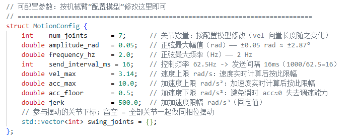

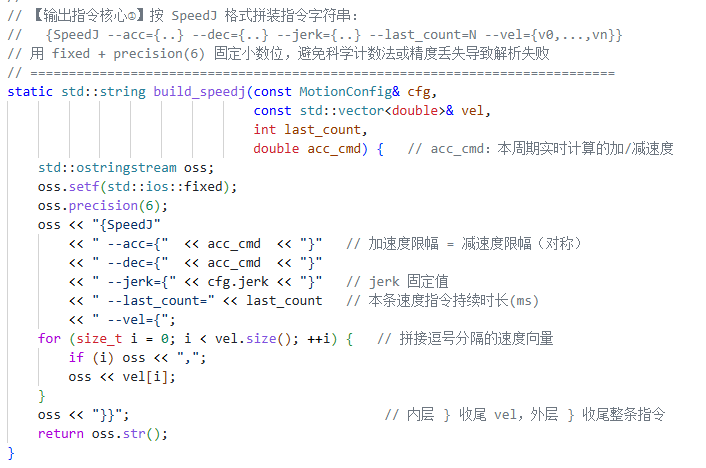

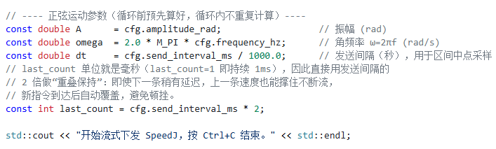

位置。其中期望的位置轨迹是θ( 𝑡 )= 𝐴⋅sin(ω⋅𝑡 )，对位置求导即可得出速度𝑣 ( 𝑡 )=θ′( 𝑡 )= 𝐴⋅ω⋅cos(ω⋅𝑡 )，最后把时间离散成小步，每一步用“当前时刻”的 𝑣 ( 𝑡 ) 下发一条 SpeedJ， 机械臂对这些速度做积分，位置就会逼近我们想要的正弦曲线。

通过 SpeedJ 实现机械臂各个关节做 sine 运动例程的相关代码如下图所示：

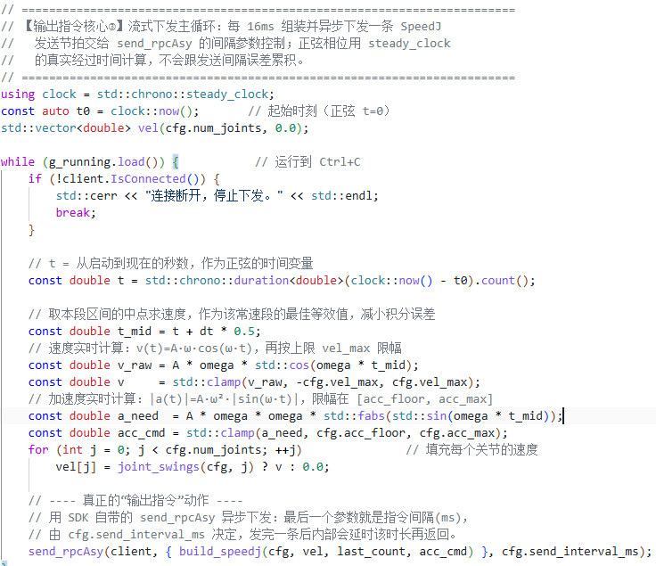

发送指令的角度数据可以写入 CSV 文件，运行 SpeedJ 的同时可以通过 Topic SDK 获取机械臂实时的关节数据。只需将 Topic 改为事件驱动模式，提取关节角度，期望关节角度和关节速度并写入 CSV；增加频率自检测，可以更精确地生成时间列；新增壁钟时间戳列，实现得知指令发送到关节运动的延迟，从而实现跨 SDK 的指令与反馈对比分析。

数据中来看，启动延迟大约为 90ms。随着时间推移两条线的形态完全同频同步，每个波峰波谷的间距固定为约 90ms，实际角度的波峰比指令的低、波谷比指令高（幅值约为指令的 72% ），这是伺服在 2Hz 高频下的正常幅值衰减。

以下图片是 sine 图像对比图（截取运动末段 5s ）：

橙色的曲线是以 Topic SDK 采集数据所绘制，蓝色的曲线是以 SpeedJ 指令发送的速度数据再做积分运算所绘制。

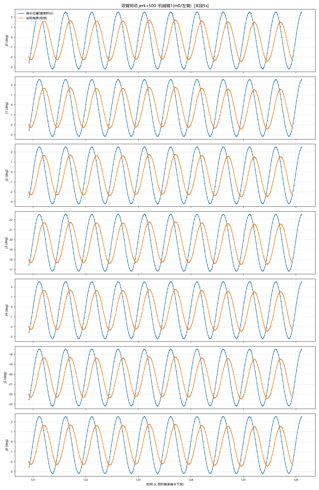

## 2.SpeedL 笛卡尔空间在线速度控制

| ➢ 指令用法 | 笛卡尔空间下，SpeedL 用于执行工具中心点（ TCP ）的线速度和角速度控制指令。用户可输入期望的笛卡尔速度向量，控制器根据设定的最大加速度（ acc ）和加加速度（ jerk ）进行速度插值规划，使 TCP 运动平滑变化。速度向量的参考坐标系由 coordinate 参数指定。 该指令属于在线速度控制指令，可周期性发送新的速度指令以实时更新 TCP 的运动状态。     当在持续时间内未收到新的 SpeedL 指令时，持续时间结束后系统会自动减速停止，使机械臂保持静止。 |  |
| --- | --- | --- |
| ➢ 指令参数 | 数据类型 | 含义 |
| --last_count | Number | 指令持续周期数 |
| --vel | Number | 末端线速度和角速度 |
| --acc | Number | 末端线加速度和角加速度 |
| --jerk | Number | 末端线加加速度和角加加速度 |
| --coordinate | Number | 0 是基坐标系，1 是工具坐标系 |
| --stop | 无 | 停止当前速度控制 |
| ➢ 指令说明 | 1.vel 参数：末端笛卡尔速度，支持多数组输入，例如 {v1，v2，v3，v4，v5，v6}，其中 v1，v2，v3 表示 xyz 线速度（ m/s ）；v4，v5，v6表示绕 xyz 轴的角速度（ rad/s ）；{v} 表示各个方向速度均为 v。  2.acc 参数：末端笛卡尔加速度，支持多数组输入，例如 --acc={2,3,4,5,6,7}，其中 2,3,4 表示 xyz 线加速度（ m/s2），5,6,7 表示绕xyz 轴的角加速度（ rad/s2）。  3.--jerk 参数：末端笛卡尔加加速度，支持多数组输入，例如 --jerk={5,6,7,8,9,0}，其中 5,6,7 表示 xyz 线加加速度（ m/s3），8,9,0 表示绕 xyz 轴的角加加速度（ rad/s3）。  4.last_count 参数：持续周期数。  该指令的持续时间，当然要是在持续时间内发送下一条该指令，则直接执行下一条指令，因为这是实时更新的。  5.stop 参数：SpeedL --stop 表明立即退出在线规划状态并减速停止运动。 |  |
| ➢ 指令示例 | 例 1：在 last_count 内均可以实时更新速度，当最后一个指令发出后在 last_count 内没有接受新 SpeedL 指令则退出在线规划状态减速停止运动。  例 2：就算在 last_count 内，发出该 SpeedL --stop 指令后会立刻退出在线规划状态并停止运动。 |  |
| 例 1  SpeedL --vel={0.005,0,0,0,0,0} --acc={2,2,2,2,2,2} --jerk={5,5,5,5,5,5} --last_count=5000 --coordinate=0  SpeedL --vel={-0.1,0,0,0,0,0} --acc={2,2,2,2,2,2} --jerk={5,5,5,5,5,5} --last_count=100 --coordinate=0 |  |  |

例 2

SpeedL --vel={0,0.1,0,0,0,0} --acc={2,2,2,2,2,2} --jerk={5,5,5,5,5,5} --last_count=100 --coordinate=1

SpeedL  --stop

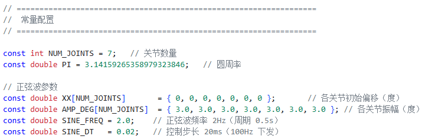

## 3.JogAnyJ 在线关节角度规划

| ➢ 指令用法 | 关节空间下，JogAnyJ 用于执行在线关节角度规划指令，支持用户实时输入任意关节角度目标点。控制器根据机器人允许的最大速度和最大加速度进行轨迹插补，使机械臂连续运动。 |  |
| --- | --- | --- |
| ➢ 指令参数 | 数据类型 | 含义 |
| --jointtarget/  --jointtarget_var/  --jointtarget_value | jointtarget | 目标关节角度（详情见 jointtarget 关节空间参数） |
| --joint_vel | Number | 关节运动速度（ rad/s ） |
| --joint_acc | Number | 关节加速度（ rad/s²） |
| --joint_dec | Number | 关节减速度（ rad/s²） |
| --last_count | Number | 等待新指令周期数 |
| ➢ 指令说明 | 1.last_count 参数：等待新指令周期数。 在指定周期内：没有新指令，退出在线规划状态，若收到新指令，继续规划运动。  2.--jointtarget 使用的是示教点位的点输入相应 name 即可，默认 P0。  --jointtarget_var 使用的是 var 定义的点输入相应 name 即可，默认 P0。  --jointtarget_value 直接输入相应数值。 |  |
| ➢ 指令示例 | 依次下发目标 ABC  例 1：机械臂运动轨迹顺序为：A → B → C  例 2：通过 JogAnyJ 的 SDK 异步发送指令，并且用 Topic 的 SDK 采集实时的机械臂各个关节数据 |  |
| 例 1  JogAnyJ --jointtarget_value={0,-1,-1.57,-1.57,1.57,0,0,0,0,0}   JogAnyJ --jointtarget_value={0,-1,-1.0,-1.57,1.57,0,0,0,0,0}  JogAnyJ --jointtarget_value={0,-1,-1.57,-1.0,1.57,0,0,0,0,0} |  |  |
| 例 2  通过 JogAnyJ 实现机械臂各个关节做 sine 运动例程的相关代码如下图所示： |  |  |

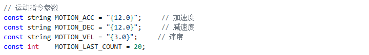

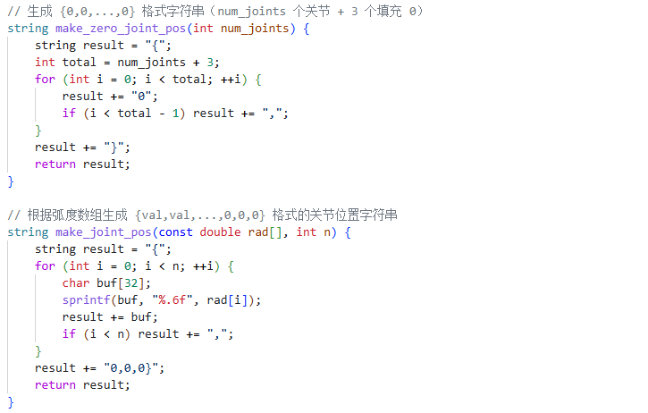

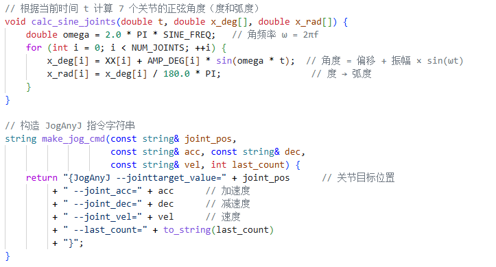

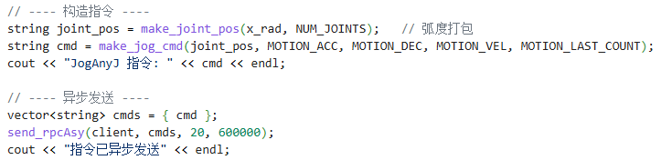

在代码中算出各个关节角度，时间采样步长和异步发送的频率保持一致，并且构造JogAnyJ 指令。在此示例中，发送的 sin 图像是振幅 3°，频率 2Hz。时间的采样步长为 0.02s，异步发送频率为 50Hz。

发送指令的角度数据可以写入 CSV 文件，运行 JogAnyJ 的同时可以通过 Topic SDK 获取机械臂实时的关节数据。只需将 Topic 改为事件驱动模式，只提取关节角度并写入 CSV；增加频率自检测，可以更精确地生成时间列；新增壁钟时间戳列，实现得知指令发送到关节运动的延迟，从而实现跨 SDK 的指令与反馈对比分析。

由所采集的数据与图表可知，在频率跟踪方面，机械臂七个关节的反馈频率高度一致，均稳定在 1.956Hz 附近，关节间离散度小于 0.0001Hz，相对于 2.000Hz 的指令频率偏低约 2.2%。需要指出的是，该偏差主要并非源于机械臂实际运动速度偏慢，而是由于 Topic 采样率显著低于指令下发频率，致使零点穿越法在稀疏采样条件下产生系统性负偏移。综合来看，七个关节的运动同步性表现优异。

延迟方面表现为两层。第一层是启动延迟：从 jog 指令发出到 Topic 检测到关节角度首次超过阈值（峰值的 10%，约 0.282°）开始大幅运动，花费 84ms，这覆盖了消息传输、控制器启动和执行器响应的全过程。第二层是运动延迟：机械臂进入稳定的正弦往复运动后，在同一位置比较指令与 Topic 反馈到达该位置的时刻。这里选取穿过 0°（均值）的过零点作为比较位置，测得反馈整体滞后指令约 98ms，且该延迟在整段 20s，约 75 个过零点上高度稳定（单次抖动仅约 ±3ms ），七个关节一致落在 97~99ms，说明系统时延恒定、无累积漂移。

需要说明的是，运动延迟（约 98ms ）与启动延迟（ 84ms ）并非两段可以累加的独立时延，而是同一条控制链路时延在不同运动阶段的两种度量：启动延迟表征系统由静止到起动的初始响应，运动延迟则反映持续正弦运动过程中每个周期所呈现的稳态相位滞后。二者在数值上相互印证，共同表明系统的真实端到端时延约为 90~98ms。

以下图片是 sine 图像对比图：

红色的曲线是以 topic SDK 采集数据并且删除指令发送和关节开始运动的延迟后所绘制，蓝色的曲线是以 JogAnyJ 指令发送的数据所绘制。

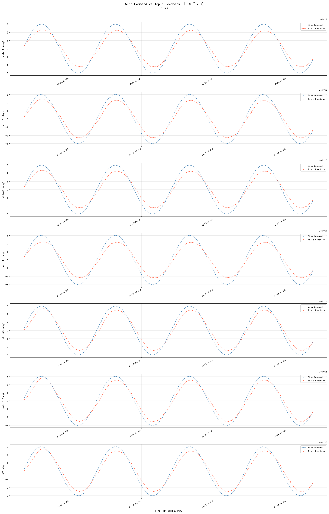

## 4.JogAnyJFast 快速运动模式

| ➢ 指令用法 | 通过 5868 端口发送指令进入快速运动模式，在快速运动模式下通过 5900\5901 端口发送关节目标位置。 |  |
| --- | --- | --- |
| ➢ 指令参数 | 数据类型 | 含义 |
| --joint_vel | Number | 关节运动速度（ rad/s ） |
| --joint_acc | Number | 关节加速度（ rad/s²） |
| --joint_dec | Number | 关节减速度（ rad/s²） |
| --last_count | Number | 指令持续周期数，默认 100ms |
| --index | Number | 指令发送的数据来源，默认是 0 |
| ➢ 指令说明 |  |  |
| 1.index 参数：index=0 时为 127.0.0.1:5900 发送的运动指令，index=1 时为 192.168.11.11:5901发送的指令。  2.last_count 参数：该指令的持续时间，当然要是在持续时间内发送下一条该指令，则直接执行下一条指令，因为这是实时更新的。 |  |  |
| ➢ 指令示例 | 例 1：通过异步发送 JogAnyJFast 指令进入快速运动模式  例 2：异步发送 JogAnyJFast 指令进入快速运动模式，并且通过127.0.0.1:5900 端口发送关节目标位置数组，让机械臂快速运动到指定位置。 |  |
| 例 1：  {JogAnyJFast --joint_vel={1.0} --joint_acc={1.0} --joint_dec={1.0} --last_count=10000 --index=0} |  |  |
| 例 2：  异步发送 JogAnyJFast 指令进入快速运动模式，并且通过 127.0.0.1:5900 端口发送关节目标位置数组，相关代码例程如下图所示： |  |  |

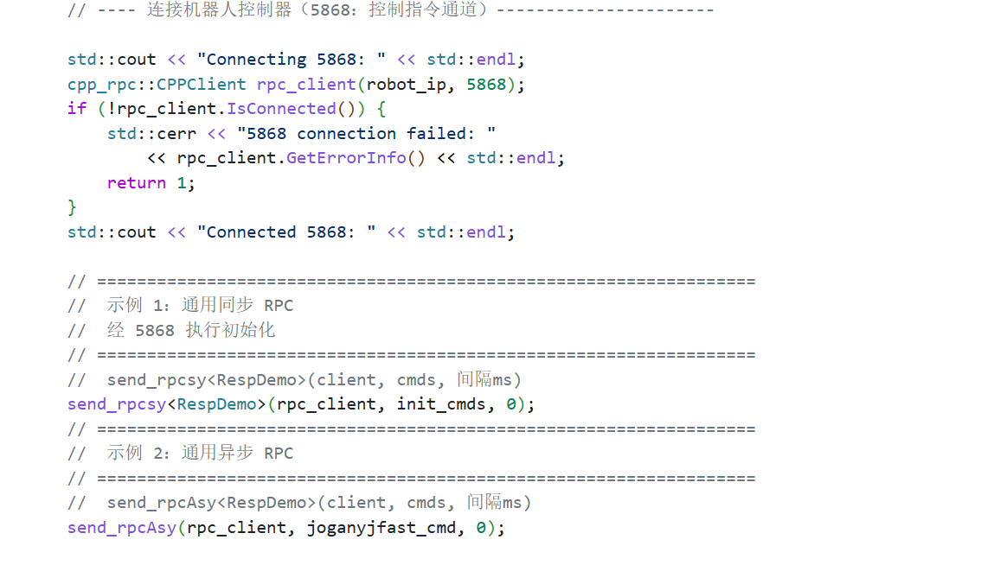

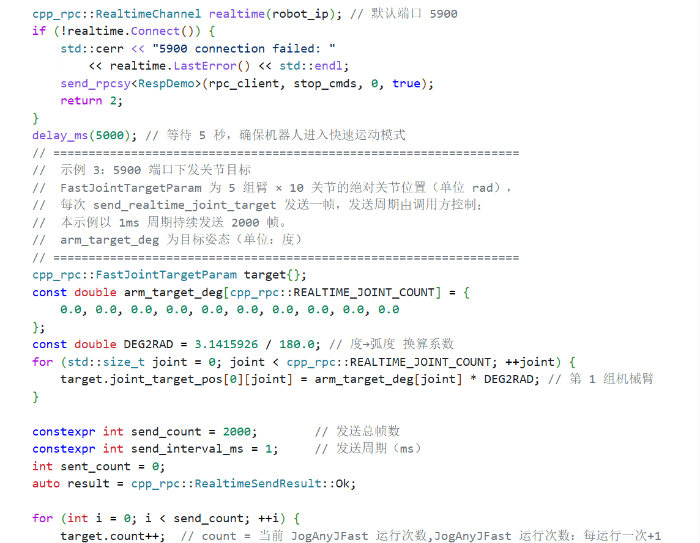

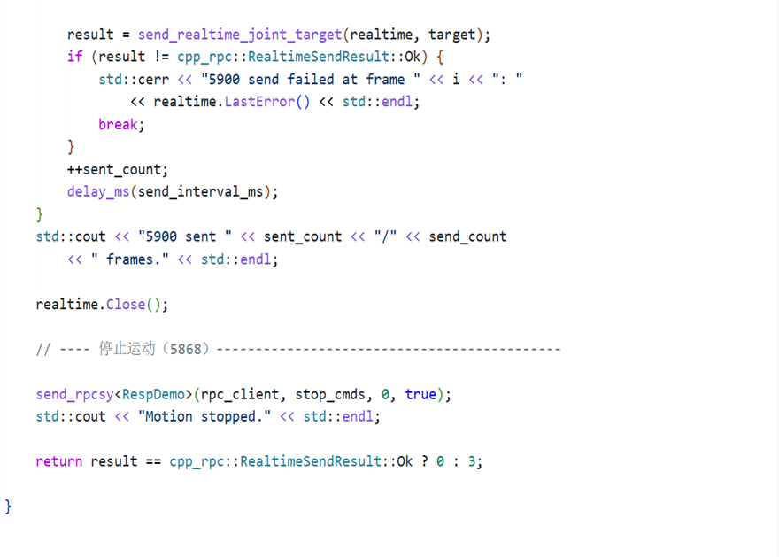

本示例演示如何通过 JogAnyJFast 使机械臂进入快速运动模式，并持续发送关节目标位置。程序使用两个通信通道：5868 端口发送初始化、模式切换和停止等控制指令；5900 端口发送关节目标数据。

程序首先连接机器人控制器，同步发送初始化指令，然后异步发送 JogAnyJFast，再建立 5900 实时连接。异步发送表示程序不等待该指令的最终响应，而是继续执行后续代码。示例在连接后等待 5 秒再发送目标，JogAnyJFast 这些参数用于设置运动模式，具体运动到哪里由目标数组决定。

在 arm_target_deg 数组中按顺序填写各关节的目标角度，单位为“度”，程序自动转换为弧度后写入第 1 组机械臂的目标数据。例如，第 2 个元素填写 30.0，表示第 2 关节的绝对目标角度为 30°，不是在当前位置上增加 30°。数组中的零表示零位目标，不表示保持当前位置，因此运行前应核对所有实际使用关节的目标。每发送一次 JogAnyJFast, 变量 count 加 1,程序最多连续发送 2000 帧，发送成功后等待 1 ms，再发送下一帧。由于目标数组没有在循环中变化，因此是在持续刷新同一个目标，而不是执行 2000 次独立运动。

实际发送间隔还受通信耗时和系统调度影响，并不保证严格的 1 ms 周期。发送完成或发生发送错误后，程序关闭 5900 连接，并通过 5868 发送 Stop 指令。发送成功只表示通信接口返回成功，不代表机械臂已经到位或停止；实际状态应结合控制器反馈确认。

## 5.JogAnyC 在线笛卡尔位姿规划

| ➢ 指令用法 | 笛卡尔空间下，JogAnyC 用于执行在线末端位置规划指令，支持实时输入三维位置目标点。控制器根据机器人允许的最大速度和加速度进行轨迹插补，使机械臂连续运动。 |  |
| --- | --- | --- |
| ➢ 指令参数 | 数据类型 | 含义 |
| --robottarget/  --robottarget_var/  --robottarget_value | robottarget | 目标点位姿信息 |
| --cartesian_vel | Number | 末端最大速度系数（ m/s ） |
| --cartesian_acc | Number | 末端最大加速度系数（ m/s2） |
| --cartesian_dec | Number | 末端最大减速度系数（ m/s2） |
| --last_count | Number | 等待新指令周期数 |
| ➢ 指令说明 | 1 执行该指令时姿态也会随目标点变化。  2.--robottarget 使用的是示教点位的点输入相应 name 即可，默认 P0。  --robottarget_var 使用的是 var 定义的点输入相应 name 即可，默认P0。  --robottarget_value 直接输入相应数值。  3.last_count 参数：等待新指令周期数。  在指定周期内：没有新指令，退出在线规划状态，若收到新指令，继续规划运动。 |  |
| ➢ 指令示例 | 依次下发目标 ABC  例 1：机械臂运动轨迹顺序为：A → B → C。 |  |
| 例 1  JogAnyC --robottarget_value={0.6,-0.25,0.3,-0.5,0.5,-0.5,0.5}   JogAnyC --robottarget_value={0.6,-0.25,0.64,0.62721137,-0.32650558,0.32650558,-0.62721137}  JogAnyC --robottarget_value={0.6,0.1,0.64,-0.5,0.5,-0.5,0.5} |  |  |

## 6.JogAnyCpos 在线笛卡尔位置规划

| ➢ 指令用法 | 笛卡尔空间下，JogAnyCpos 用于执行在线末端位置控制指令，支持基于当前位置的实时点动控制。控制器根据设定的速度、加速度对当前 TCP 位置进行直接驱动，使机械臂按指令连续运动。 |  |
| --- | --- | --- |
| ➢ 指令参数 | 数据类型 | 含义 |
| --cartesian_pos | Matrix | 目标点位置信息 |
| --cartesian_vel | Number | 末端最大速度系数（ m/s ） |
| --cartesian_acc | Number | 末端最大加速度系数（ m/s2） |
| --cartesian_dec | Number | 末端最大减速度系数（ m/s2） |
| --last_count | Number | 等待新指令周期数 |
| --zone_ratio | Number | 轨迹平滑比例 |
| --clear_buffer | Number | 是否清空缓存队列 |
| ➢ 指令说明 | 1.--cartesian_pos 参数是位置信息 {x,y,z}，单位是 m。  2.last_count 参数：等待新指令周期数。  在指定周期内：没有新指令，退出在线规划状态，若收到新指令，继续规划运动。  3.zone_ratio 参数：控制轨迹平滑过渡。  当目标点剩余轨迹比例小于 zone_ratio：接入下一个目标点，实现平滑运动。  4.clear_buffer：是否清空缓存队列。  若不启用，则依次运行之前设定的目标点位，若启用，则清除尚未执行的目标点  位，并插入新的目标点位，且打断正在执行的目标点直接执行新的目标点。 |  |
| ➢ 指令示例 | 依次下发目标 ABC  例 1：机械臂运动轨迹顺序为：A → B → C  例 2：若下发目标 C 时已经开始执行目标 A  则立刻直接执行目标 C（打断了正在执行的目标 A ） |  |
| 例 1  JogAnyCpos --cartesian_pos={0.6,-0.25,0.3}  JogAnyCpos --cartesian_pos={0.6,-0.25,0.6} --zone_ratio=0.05 --clear_buffer=0  JogAnyCpos --cartesian_pos={0.42,-0.28,0.74} --clear_buffer=0 |  |  |
| 例 2  JogAnyCpos --cartesian_pos={0.6,-0.25,0.3} --zone_ratio=0.05 --clear_buffer=0  JogAnyCpos --cartesian_pos={0.6,-0.25,0.64}  --zone_ratio=0.05 --clear_buffer=0  JogAnyCpos --cartesian_pos={0.6,0.1,0.64} --zone_ratio=0.05  --clear_buffer=1 |  |  |

## 7.SetEgmOffset 在线偏移控制

| ➢ 指令用法 | 用于设置 EGM 在线偏移量，在机器人运动过程中对规划轨迹进行在线修正 |  |
| --- | --- | --- |
| ➢ 指令参数 | 数据类型 | 含义 |
| --pos_offset | Matrix | 位置偏移量，用于设置机器人末端的目标偏移量 |
| --vel_offset | Matrix | 速度偏移量，用于设置机器人末端的速度偏移量 |
| --egmplanner_id | Number | EGM 规划器编号，用于指定当前使用的 EGM planner |
| --max_vel | Number | 最大速度限制 |
| --max_acc | Number | 最大加速度限制 |
| --max_dec | Number | 最大减速度限制 |
| --coordinate | Number | 偏移参考坐标系，0 表示基坐标系，1 表示工具坐标系 |
| --control_mode | Number | 控制模式选择，用于指定当前在线偏移的控制方式 |
| ➢ 指令说明 | SetEgmOffset 用于在线修改机器人运动过程中的偏移量，可用于轨迹微调、实时补偿等场景。  pos_offset 表示位置偏移量，vel_offset 表示速度偏移量，二者可根据实际控制需求进行设置。  max_vel、max_acc、max_dec 用于限制偏移过程中的速度、加速度和减速度，避免偏移过程过快导致运动不平滑。 |  |
| ➢ 指令示例 | 例 1：设置机器人在基坐标系下对 x 偏移 0.01m   例 2：设置机器人在工具坐标系下进行速度偏移 |  |
| 例 1  SetEgmOffset --pos_offset={0.01,0,0} --max_vel=0.005 --max_acc=0.3 --max_dec=0.3 --coordinate=0  例 2  SetEgmOffset --vel_offset={0.003,0,0} --max_vel=0.005 --max_acc=0.3 --max_dec=0.3 --coordinate=1 |  |  |

# 六、高级规划指令

可实现直线、圆弧轨迹。七轴情况下需要开启“最优求解”模式，参考“系统指令”：SetUsingSP。

## 1.MoveBlend 笛卡尔空间下轨迹融合 ( 局部 )

| ➢ 指令用法 | 笛卡尔空间下，MoveBlend 用于对相邻两段运动之间的拐点进行局部轨迹融合，通过在拐角处引入过渡曲线（如圆弧或平滑段），避免速度突变和频繁启停。 |  |
| --- | --- | --- |
| ➢ 指令参数 | 数据类型 | 含义 |
| --robottarget/  --robottarget_var/ --robottarget_value | robottarget | 目标点位置变量（详情见 robottarget 笛卡尔空间参数） |
| --mid_robottarget/  --mid_robottarget_var/  --mid_robottarget_value/ | robottarget | 中间点位置变量（调用和 robottarget 笛卡尔空间参数相同） |
| --speed/  --speed_var/  --speed_value/ | speed | 速度变量（详情见 speed 速度参数） |
| --type | String | 插值类型，默认 insert |
| --zone | zone | 轨迹融合变量（详情见 zone 转弯半径） |
| --ratio | Number | 加速度和速度的比值 |
| --is_optimal | Number | 当使用 MoveBlendOptimalPos 时，参数设为1 |
| ➢ 指令说明 |  |  |
| 1.zone 参数：第一个参数（单位 m ）表示空间过渡容差，越小越接近原来轨迹，允许轨迹在空间上“偏离目标点”的最大距离。  2. 轨迹点姿态可以变化，执行轨迹时姿态变化也会执行，但有姿态变化时，速度会降低（比较慢）。  3. 运动类型，type=first_insert 当前位置为起点标记类型（固定的）后面不用加其他参数，type=insert_line 直线轨迹点类型，type=insert_circle 圆弧轨迹点类型，type=start 执行的类型（固定的）后面不用加其他参数。  4. 每段速度可以单独决定，由标记字段指令 speed 决定。 |  |  |
| ➢ 指令示例 | 例 1 笛卡尔空间下轨迹融合直线运动  例 2 笛卡尔空间下轨迹融合圆弧运动  例 3 笛卡尔空间下轨迹融合圆弧运动（整圆）  例 4 笛卡尔空间下轨迹融合配合在线偏移控制 |  |
| 例 1   MoveBlend --type=first_insert  // 起点  MoveBlend --type=insert_line --robottarget_value={0.036,0,0.9,0,0,0,1} --zone={0,0} --speed=v100  // 直线轨迹点标记起点到标记点 2 |  |  |

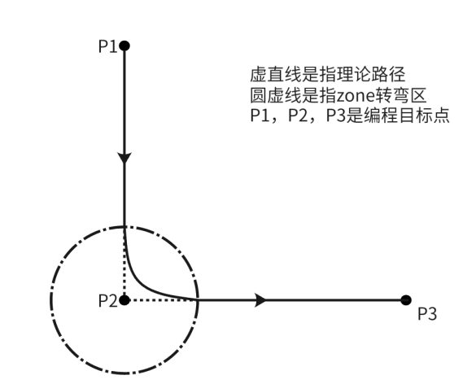

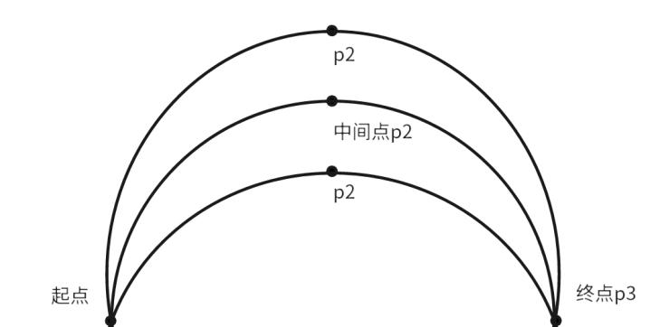

MoveBlend --type=insert_line --robottarget_value={0.036,-0.068,0.9,0,0,0,1} --zone={0.05,0.25} --speed=v100  //zone 越大，可脱离原轨迹程度越大，zone 转弯区直径为 0.05m

MoveBlend --type=insert_line --robottarget_value={-0.083,-0.068,0.9,0,0,0,1} --zone={0,0} --speed=v100

MoveBlend --type=start  // 执行命令，速度不由这一行决定，由标志点决定

// 其他省略的参数均为默认值

笛卡尔空间下轨迹融合直线运动如图下所示

例 2

MoveBlend --type=first_insert  // 起点

MoveBlend --type=insert_circle --mid_robottarget_value={0.36,-0.28,0.48,0,1,0,0} --robottarget_value={0.40,-0.32,0.48,0,1,0,0} --zone={0.1,0.1} --speed=v300

// 圆弧轨迹点标记，zone 越大，可脱离原轨迹程度越大，以 mid_robottarget 作为中间点，圆弧运动到 robottarget

MoveBlend --type=start  // 执行命令，速度不由这一行决定，由标志点决定

// 其他省略的参数均为默认值

笛卡尔空间下轨迹融合圆弧运动如图下所示

例 3 笛卡尔空间下轨迹融合圆弧运动 ( 整圆 )

MoveBlend --type=first_insert   // 需要机械臂末端位姿在运动前就在 robottarget 点

MoveBlend --type=insert_circle --robottarget_value={0.524,-0.15,0.684,-0.5,0.501,-0.499,0.498} --mid_robottarget_value={0.523,-0.15,0.754,-0.483,0.489,-0.516,0.509} --speed=v30 --zone={0,0} --is_optimal=0   //robottarget 点为终点，mid_robottarget 点为中间点，为末端轨迹是确保完整的圆，zone 值建议为 0

MoveBlend --type=start  // 执行命令

笛卡尔空间下轨迹融合圆弧运动 ( 整圆 ) 如图下所示

例 4 笛卡尔空间下轨迹融合配合在线偏移控制

Var --type=robottarget --name=p1 --value={0.279,0,0.466,0,1,0,0.008}  // 定义轨迹点位姿

Var --type=robottarget --name=p2 --value={0.326,0,0.465,0,0.999,0,0.037}

Var --type=robottarget --name=p3 --value={ 0.326,0.052,0.465,-0.067,0.996,0.019,0.042}

Var --type=robottarget --name=p4 --value={ 0.278,0.047,0.466,-0.065,0.997,0.02,0.004}

SetEgmOffset --pos_offset={0.06,0,0} --max_vel=0.05 --max_acc=0.3 --max_dec=0.3 --egmplanner_id=0 --coordinate=0 --vel_offset={0,0,0} --control_mode=0  // 设置各个点位 x 的正方向偏移量，例 4 中是 x 正方向偏移 0.06m

MoveBlend --type=first_insert  // 需要机械臂末端位姿在运动前就在 p4 点

MoveBlend --type=insert_line --robottarget_var=P1 --zone={0,0} --speed=v30  // 直线轨迹点标记起点到 P1

MoveBlend --type=insert_line --robottarget_var=P2 --zone={0,0} --speed=v30

MoveBlend --type=insert_line --robottarget_var=P3 --zone={0,0} --speed=v30

MoveBlend --type=start  // 执行命令

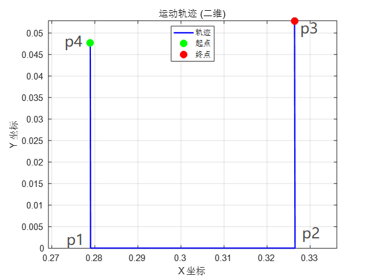

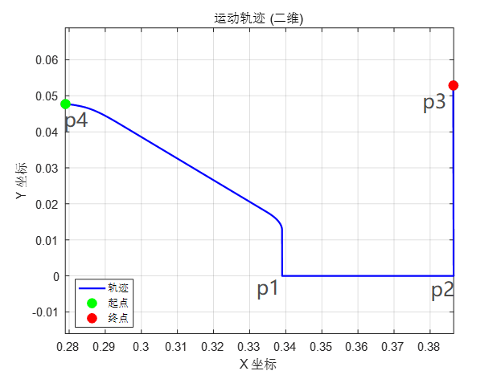

设置 EGM 前机械臂末端 MoveBlend 的轨迹

设置 EGM 后机械臂末端 MoveBlend 的轨迹

从两张对比图可以看出，在设置在线偏移控制前的机械臂运动轨迹，p4 点和 p1 点 x 坐标值相同，y 坐标值不同，设置在线偏移控制后的机械臂运动轨迹，p1，p2，p3 点位的 x 坐标值都正方向偏移 0.06m。

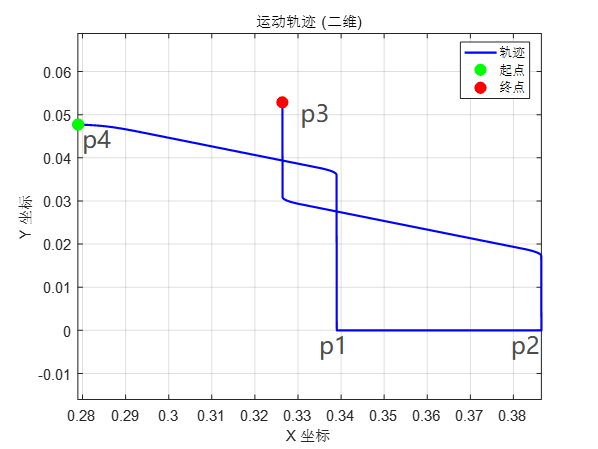

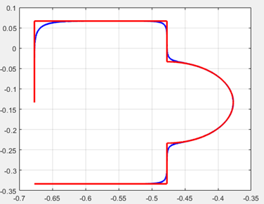

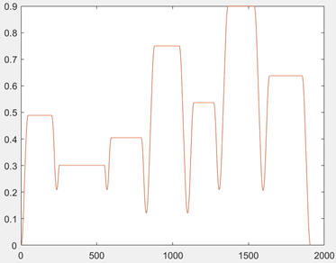

EGM 可以在机械臂运动过程中设置。如图所示，设置 EGM 后，当机械臂运动到 p2 到p3 点过程中重置 EGM 时，机械臂末端 MoveBlend 的轨迹发生 x 负方向上的偏移。

➢ 轨迹特性说明对比

下图展示了一条由直线与圆弧组合而成的基础路径。在未启用 zone 轨迹融合时（类似于采用 MoveL 指令），相邻路径段在连接处存在明显拐角，机械臂需要在该位置进行减速甚至停顿，轨迹在运动学上不满足平滑连续（红色曲线）。

当启用 zone 轨迹融合机制后，控制器会在路径连接处自动插入过渡曲线，使相邻路径段实现平滑过渡，从而形成连续光滑的运动轨迹（蓝色曲线）。

同时，从速度曲线可以看出，在启用 zone 融合后，机械臂在路径连接处不会降低至 0 速度再启动下一段轨迹，而是在满足约束条件的情况下保持连续速度过渡，从而减少频繁启停，提高整体运动效率与轨迹平滑性。

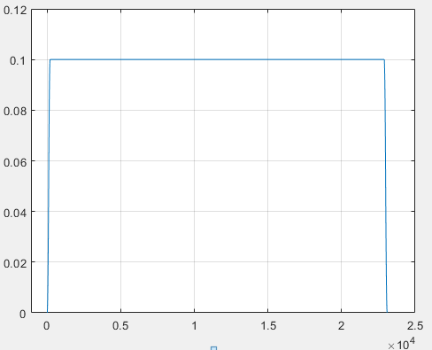

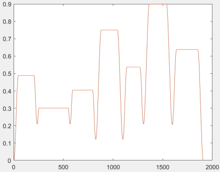

## 2.MoveBlendScurve 笛卡尔空间下轨迹融合（匀速）

| ➢ 指令用法 | 笛卡尔空间下，机械臂末端执行基于 S 曲线插值算法的融合轨迹运动，用于实现复杂运动中，运动线速度按照制定曲线运动，适用于涂胶、打磨等恒速情形下。 |  |
| --- | --- | --- |
| ➢ 指令参数 | 数据类型 | 含义 |
| --speed/--speed_var/--speed_value | speed | 速度变量（详情见 speed 速度参数） |
| --acc | Number | 笛卡尔加速度，单位为 m/s2 |
| --jerk | Number | 笛卡尔加加速度，单位为 m/s3 |
| ➢ 指令说明 |  |  |
| 1.zone 参数：第一个参数（ m ）表示空间过渡容差，越小越接近原来轨迹，允许轨迹在空间上“偏离目标点”的最大距离。  第二个参数表示姿态过渡容差，允许姿态不完全对齐就进入下一段轨迹。  2. 轨迹仅执行位置变化，就算轨迹点姿态变化了，也不会执行姿态变化，但也不会报错。  3. 运动类型，type=first_insert 当前位置为起点标记类型（固定的）后面不用加其他参数，type=insert_line 直线轨迹点类型，type=insert_circle 圆弧轨迹点类型，MoveBlendScurve 执行。  4. 每段速度不可以单独决定，由 MoveBlendScurve 指令 speed 决定。 |  |  |
| ➢ 规划特性说明对比 | 左图为 MoveBlendScurve 执行时的末端线速度变化曲线。可以看出，末端线速度按照设定的 S 曲线规律进行加速与减速，速度变化过程连续且平滑。  相比 MoveBlend 的速度规划方式（右图），MoveBlendScurve 对末端线速度进行了显式规划，使速度曲线呈现规则的 S 型变化，避免速度突变或波动，从而获得更加稳定的进给速度。因此，该指令更适用于对末端线速度稳定性要求较高的工艺场景，例如涂胶、打磨、喷涂等。 |  |

➢ 跑固定曲线说明

该指令为分段插值方式，连续曲线必须先离散为多个点。步骤如下

1. 曲线离散化（最好时间参数化），将连续曲线转换为一组有序且连续的 robottarget 点。

2. 使用 --type=first_insert 标记当前位姿为起点。

3. 使用 --type=insert_line 依次插入离散点。

4. 使用 MoveBlendScurve 指令统一设定速度并执行轨迹。

注意事项：1. 点与点空间距离不小于 2mm。

2. 单次轨迹点建议不要超过 300 个。

3.zone 尽可能设小点比如 {0.001,0.01}，越小越接近原轨迹。

4. 建议起点为第一个点，否则可能会报二次不连续。

➢ 指令示例

例 1

MoveBlend --type=first_insert  // 起点

MoveBlend --type=insert_line --robottarget_value={0.491,-0.1,0.687,-0.5,0.5,-0.5,0.5} --zone={0.1,0.1}// 直线轨迹点标记

MoveBlend --type=insert_line --robottarget_value={0.491,-0.0,0.687,-0.5,0.5,-0.5,0.5} --zone={0.1,0.1}

MoveBlend --type=insert_line --robottarget_value={0.491,-0.0,0.687,-0.5,0.5,-0.5,0.5} --zone={0.1,0.1}

MoveBlendScurve --speed=v100 // 执行命令，速度仅由这一行决定 // 其他省略的参数均为默认值

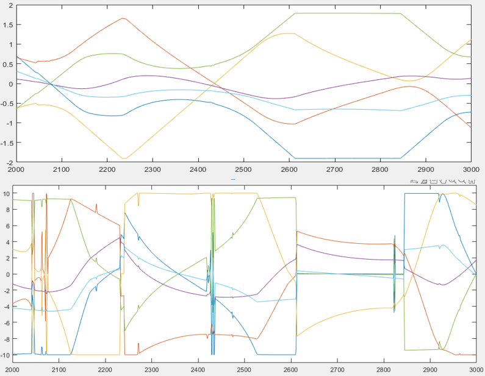

## 3.MoveBlendOptimalPos 笛卡尔空间下轨迹融合（最大速）

| ➢ 指令用法 | 笛卡尔空间下，机械臂末端执行融合轨迹运动，生成的轨迹在满足关节电机最大速度、最大加速度、最大力矩的前提下，尽快的完成运动。 |  |
| --- | --- | --- |
| ➢ 指令参数 | 数据类型 | 含义 |
| --acc_coef | Number | 加速度系数，值越大，轨迹加速越快 |
| --vel_coef | Number | 速度系数，值越大，运行越快 |
| --dynamics_constraint | Number | 是否启用机器人动力学约束。1 表示启用（默认），0 表示忽略约束。 |
| --vel_gain | Number | 优化中速度约束的调节增益 |
| --acc_gain | Number | 优化中加速度约束的调节增益 |
| ➢ 指令说明 |  |  |
| 1. 轨迹点姿态不要变化，否则会影响到计算，可能会失败。  2. 运动类型，type=first_insert 当前位置为起点标记类型（固定的）后面不用加其他参数，type=insert_line 直线轨迹点类型，type=insert_circle 圆弧轨迹点类型，MoveBlendOptimalPos 执行。  3. 采用此指令时，标记点字段需要加上 --is_optimal=1。 |  |  |
| ➢ 轨迹特性说明 | 时间最优规划生成的轨迹在满足关节最大速度、最大加速度及最大力矩约束的前提下，尽可能缩短整体运动时间。  下图为各关节的速度曲线和加速度曲线。可以看出，在运动过程中始终存在某一关节的速度或加速度接近其约束上限，说明轨迹规划充分利用了机器人动力学能力，从而实现时间最优运动。 |  |

➢ 指令示例

例 1

MoveBlend --type=first_insert // 起点标记

MoveBlend --type=insert_line --robottarget_value={0.491,-0.1,0.687,-0.5,0.5,-0.5,0.5} --zone={0.1,0.1} --is_optimal=1// 直线轨迹点标记

MoveBlend --type=insert_line --robottarget_value={0.491,-0.0,0.687,-0.5,0.5,-0.5,0.5} --zone={0.1,0.1} --is_optimal=1

MoveBlend --type=insert_line --robottarget_value={0.491,0.02,0.587,-0.5,0.5,-0.5,0.5} --zone={0.1,0.1} --is_optimal=1// 采用示教点位时，加上这个参数

MoveBlendOptimalPos --acc_coef=0.9 --vel_coef=0.9 --dynamics_constraint=0

// 执行命令 // 其他省略的参数均为默认值

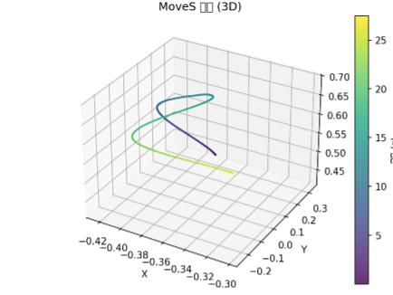

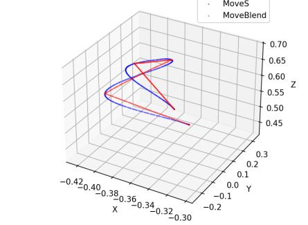

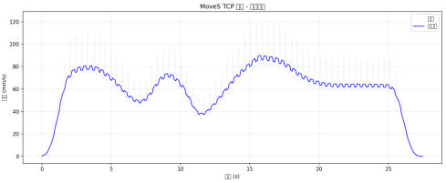

## 4.MoveS 笛卡尔空间下轨迹融合（全程）

| ➢ 指令用法 | 笛卡尔空间下，用于对多个路径点进行整体样条拟合，生成一条全局连续的平滑轨迹，属于全局融合 |  |
| --- | --- | --- |
| ➢ 指令参数 | 数据类型 | 含义 |
| --robottarget/  --robottarget_var/  --robottarget_value/ | robottarget | 目标点位置变量（详情见 robottarget 笛卡尔空间参数） |
| --speed/  --speed_var/  --speed_value/ | speed | 速度变量（详情见 speed 速度参数） |
| --type | String | 插值类型，默认 insert |
| --ratio | Number | 加速度和速度的比值 |
| ➢ 指令说明 |  |  |
| 1.MoveS 生成的轨迹通过 ratio 来改变机械臂运动速度平滑程度。  2. 运动类型，type=first_insert 当前位置为起点标记类型（固定的）后面不用加其他参数，type=insert 轨迹点标记，type=start 执行。  3. 每段速度可以不单独决定，由 MoveS --type=start 后 speed 决定。  4.ratio 越大，整体轨迹所用时间越短（ speed 越大越明显） |  |  |
| ➢ 轨迹特性说明 | 下图为 MoveS 执行时生成的末端运动轨迹和 MoveS 与 MoveBlend 相同插入点的轨迹图，可以看出 1. 轨迹通过对所有路径点进行整体样条拟合后形成一条连续平滑的空间曲线；2. 在路径点处不会形成明显拐角，而是在路径点附近进行平滑过渡。   下图为 MoveS 的速度随时间分布图，可以从中看到 1. 轨迹在经过插入点时会减速平稳度过插入点；2. 每一段轨迹加速减速平稳。 |  |

➢ 跑固定曲线说明

该指令为全局样条拟合方式，适合连续曲线运行。步骤如下：

1. 曲线离散化（建议按时间参数化），生成一组有序 robottarget 点。

2. 使用 --type=first_insert 标记当前位姿为起点。

3. 使用 --type=insert 依次插入所有离散点。

4. 使用 --type=start 并设置 speed 与 ratio 执行轨迹并开始执行。

注意事项：1. 点与点空间距离不小于 2mm。

2. 单次轨迹点建议不要超过 320 个。

3. 点数较少且线比较曲折，起点最好不要是第一个点。

➢ 指令示例

例 1

MoveS --type=first_insert  // 起点

MoveS --type=insert --robottarget_value={0.491,0.02,0.587,-0.5,0.5,-0.5,0.5} // 轨迹点标记

MoveS --type=insert --robottarget_value={0.491,0.0,0.687,-0.5,0.5,-0.5,0.5} // 轨迹点标记

MoveS --type=insert --robottarget_value={0.471,0.02,0.587,-0.5,0.5,-0.5,0.5} // 轨迹点标记

MoveS --type=start --speed=v200  // 执行命令，速度仅由这一行决定，不由轨迹点速度决定 // 其他省略的参数均为默认值

## 5.ServoSeries 关节空间下轨迹融合指令

| ➢ 指令用法 | 关节空间连续运动，连续插值轨迹控制指令，用于向控制器发送一系列关节空间目标点，实现机械臂轨迹的平滑执行，适用于实时控制和柔顺运动场景。 |  |
| --- | --- | --- |
| ➢ 指令参数 | 数据类型 | 含义 |
| --jointtarget  --jointtarget_var  --jointtarget_value | jointtarget | 目标关节角度（详情见 jointtarget 关节空间参数） |
| --time | Number | 需要完成对应期望关节位置的时间列表 |
| --type | String | 命令类型（ insert/first_insert/start ） |
| --scale | Number | 时间缩放比例，设置的时间列表 *scale 是最终执行的时间列表 |
| ➢ 指令说明 |  |  |
| 用户设置一系列的期望关节位置和其对应的时间列表，指令对于不同关节位置间进行插值，在设置的时间点完成对应的期望关节位置。 |  |  |
| ➢ 指令示例 | 例 1 中，设置了 3 组期望关节位置，首先需要设置初始位置为起始点，然后开始 servoseries 指令，缩放比例为 1，先花费 1 秒到达第一个点位，再花费 3.2 秒到达第二个点位，再花费 6.3 秒到达第三个点位。 |  |
| 例 1  ServoSeries --type=first_insert  ServoSeries --type=insert --jointtarget_value={0,-1,-1.57,-1.57,1.57,0,0,0,0,0} --time=1  ServoSeries --type=insert --jointtarget_value={1,-1,-1.57,-1.57,1.57,0,0,0,0,0} --time=3.2  ServoSeries --type=insert --jointtarget_value={0,-1,-1.57,1.57,-1.57,0,0,0,0,0} --time=6.3  ServoSeries --type=start |  |  |

## 6.MoveSeriesToppJ 关节空间下轨迹融合（最大速）

| ➢ 指令用法 | 关节空间下，用于以关节空间轨迹的形式，按照时间最优方式执行一系列关节点，确保在速度和加速度约束下，实现最快的轨迹跟踪。 |  |
| --- | --- | --- |
| ➢ 指令参数 | 数据类型 | 含义 |
| --jointtarget  --jointtarget_var/  --jointtarget_value | jointtarget | 需要完成的期望关节位置列表（详情见 jointtarget关节空间参数） |
| --type | String | 插入类型 |
| --acc_coef | Number | 加速度系数，范围为（ 0,1], 值越大 , 轨迹加速越快（默认 0.8 ） |
| --vel_coef | Number | 速度系数，范围为（ 0,1]，值越大，运行越快（默认 0.9 ） |
| ➢ 指令说明 |  |  |
| 1. 轨迹点应事先设定为顺序连续的姿态 / 关节数据，避免大角度跳变。  2. 点之间不能出现突变或不可达配置，否则插值会失败。  3.value 是关节角度信息，定义的标准格式为 10 个，数值为空时填 0。 |  |  |
| ➢ 指令示例 |  |  |
| 例 1  MoveSeriesToppJ --type=first_insert  MoveSeriesToppJ --type=insert --jointtarget_value={0.0,-1.57,-1.57,-1.57,1.57,0.0,0,0,0,0}  MoveSeriesToppJ --type=insert --jointtarget_value={0.0,-1.57,-1.13,-1.57,1.57,0.0,0,0,0,0}  MoveSeriesToppJ --type=insert --jointtarget_value={0.52,-1.57,-1.13,-1.57,1.57,0.0,0,0,0,0}  MoveSeriesToppJ --type=start |  |  |

# 七、力控指令

## 1. 六维力传感器概述

功能介绍

六维力 / 力矩传感器用于实时测量机械臂末端的三维力（ Fx,Fy,Fz ）和三维力矩（ Mx,My,Mz ），支持力控与柔顺操作，主要功能包括：

• 实时采集力 / 力矩数据，用于柔顺控制和力控运动。

• 支撑 ForcePositionHybridControl 等指令。

• 提供零漂补偿与标定，保证静止状态下输出接近零。

• 可设置死区与力阈值，提高操作安全性。

安装指南

• 安装在机械臂末端执行器与工具之间，保证传感器与工具坐标系重合且测量轴线要对齐。

• 固定牢靠，避免松动或额外扭矩影响测量精度。

• 电缆连接稳固，避免拉伸或干扰。

• 设置工具坐标系 SetTool 以匹配实际工具方向。

标定与零漂

• 标定目的：消除初始偏置，保证静止输出接近零。

• 标定方法：执行 CalibFtDyn 指令，机械臂缓慢运动采集数据计算零点。

• 零漂补偿：标定后控制系统自动减去偏置值。

注意事项：机械臂静止、无外力干扰；更换工具或平台需重新标定。

## 2.ForcePositionHybridControl 笛卡尔空间下力 - 位混合控制

| ➢ 指令用法 | 笛卡尔空间下，机器人末端沿设定方向感受到外力时做出运动响应，形成柔顺拖动控制（基于六维力的拖动示教），开启位置控制后，可以让机器人在移动过程中具备柔顺性，对外力进行反馈。 |  |
| --- | --- | --- |
| ➢ 指令参数 | 数据类型 | 含义 |
| --force_direction | Matrix | 允许进行拖动的自由度（方向），1 表示启用，0 表示禁用 |
| --damping_gain | Matrix | 各个自由度（方向）拖动示教灵敏度参数，值越大越易拖动 |
| --stiffness_gain | Matrix | 各个自由度（方向）的刚度参数，用于描述末端在受力偏移后回到参考位置的趋势，值越大，回正能力越强，柔顺性相对减弱 |
| --force_target | Matrix | 力控自由度的期望力 |
| --vel_limit | Matrix | 拖动过程中的速度限制 |
| --acc_limit | Matrix | 拖动过程中的加速度限制 |
| --open_tg | Number | 1 表示启用力 - 位置混合控制，0 表示禁用 |
| --coordinate | Number | 拖动时参考坐标系，1 为工具坐标系（默认），0 为基坐标系 |
| --cutoff_freq | Number | 六维力传感器数据一阶低通滤波器 |
| ➢ 指令说明 |  |  |
| 要将六维力传感器坐标系与工具坐标系对齐，否则方向可能会不对，该指令可以支持运行中，再发送新的 ForcePositionHybridControl 指令 |  |  |
| ➢ 指令示例 | 例 1，开启 6 个方向的拖动，期望力为 0，就可以对机械臂进行笛卡尔空间下拖动。  例 2，开启 z 方向的拖动，给传感器 z 方向的力，末端就会朝着相应的方向移动。  例 3，直线运动到 p1，在运动过程中开启 z 方向的力控且期望力为 6。  例 4，设置 stiffness_gain 的值，使得拖动结束之后会呈现弹簧的效果回到参考位置。  例 5，与 SetEgm 融合使用，在进行力控制中进行偏移。  例 6，在线更改目标力。  例 7，设置力控参考点与工具坐标系一致。 |  |
| 例 1  ForcePositionHybridControl --force_direction={1,1,1,1,1,1} --damping_gain={0.03,0.03,0.03,0.3,0.3,0.3}  例 2  ForcePositionHybridControl --force_direction={0,0,1,0,0,0} --damping_gain={0.03,0.03,0.03,0.3,0. |  |  |

3,0.5} --force_target={0,0,5,0,0,0}

// 其它参数可省略采用默认

例 3

Var --type=robottarget --name=p1 --value={0.490,0.1,0.680,0,0.70710678,0,0.70710678}

MoveBlend --type=first_insert

MoveBlend --type=insert_line --robottarget=p1

ForcePositionHybridControl --force_target={0,0,6,0,0,0} --force_direction={0,0,1,0,0,0} --open_tg=1

例 4

(1) 力控制＋弹簧效果

ForcePositionHybridControl --force_direction={0,0,1,0,0,0} --damping_gain={0.03,0.03,0.03,0.3,0.3,0.3} --stiffness_gain={0,0,1000,0,0,0}

(2) 力位混合控制＋弹簧效果

Var --type=robottarget --name=p1 --value={0.490,0.1,0.680,0,0.70710678,0,0.70710678}

MoveBlend --type=first_insert

MoveBlend --type=insert_line --robottarget=p1

ForcePositionHybridControl --force_direction={1,1,1,1,1,1} --damping_gain={0.01,0.01,0.01,0.1,0.1,0.1} --open_tg=1 --stiffness_gain={0,0,1000,0,0,0}

例 5

(1) 力控制＋偏移

SetEgmOffset --pos_offset={0.1,0,0} --max_vel=0.005 --max_acc=0.3 --max_dec=0.3

ForcePositionHybridControl --force_direction={0,0,1,0,0,0} --damping_gain={0.03,0.03,0.03,0.3,0.3,0.5} --force_target={0,0,5,0,0,0}

(2) 力位混合控制＋偏移

先定义一个点位，再下发偏移指令

Var --type=robottarget --name=p1 --value={0.490,0.1,0.680,0,0.70710678,0,0.70710678}

SetEgmOffset --pos_offset={0.1,0,0} --max_vel=0.005 --max_acc=0.3 --max_dec=0.3

最后开始力位混合控制指令

MoveBlend --type=first_insert

MoveBlend --type=insert_line --robottarget=p1

ForcePositionHybridControl --force_target={0,0,6,0,0,0} --force_direction={0,0,1,0,0,0} --open_tg=1

例 6

先下发

ForcePositionHybridControl --force_direction={0,0,1,0,0,0} --damping_gain={0.03,0.03,0.03,0.3,0.3,0.5} --force_target={0,0,5,0,0,0}

后在线更改目标力再下发

ForcePositionHybridControl --force_direction={0,1,1,0,0,0} --damping_gain={0.03,0.03,0.03,0.3,0.3,0.5} --force_target={0,2,-5,0,0,0}

例 7

Var --type=tool --name=tool_ft --value={0,0,0.15,0,0,0,1}  // 该点表示目标工具点相对于末端法兰坐标系的位置和姿态

SetFtPq --pq={0,0,0.15,0,0,0,1}  // 将六维力传感器的力 / 力矩显示参考点设置为同一个点

ForcePositionHybridControl --force_direction={1,1,1,1,1,1} --damping_gain={0.03,0.03,0.03,0.3,0.

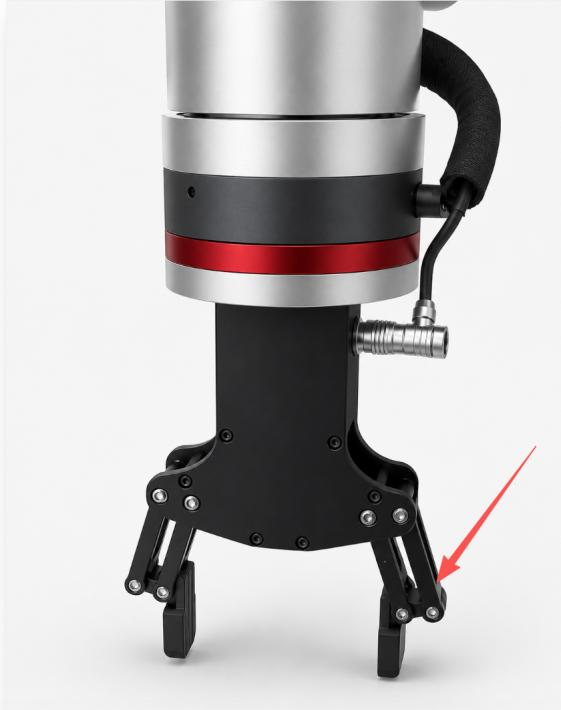

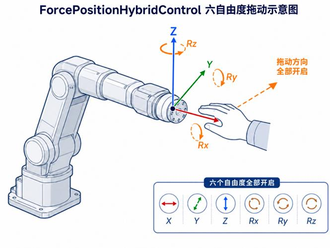

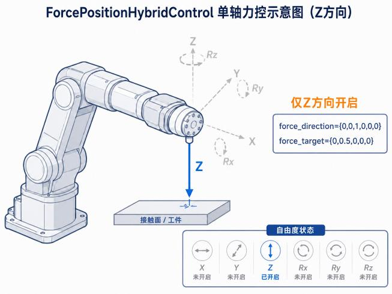

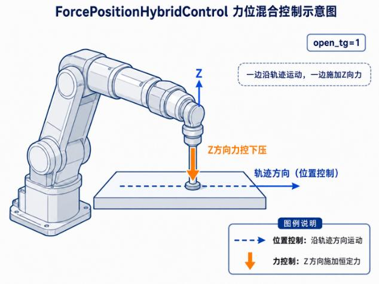

3,0.3} --force_target={0,0,0,0,0,0} --coordinate=1  // 开启 6 个方向的力控拖动，拖动参考坐标系为工具坐标系

## 3.DragInCST 电流环下机器人拖动控制

| ➢ 指令用法 | 机器人根据关节电流、关节力矩或外部拖动力做出运动响应，实现机器人拖动示教功能。 |  |
| --- | --- | --- |
| ➢ 指令参数 | 数据类型 | 含义 |
| --cf_coef | Matrix | 库伦摩擦补偿比例因子，用于调节已辨识库伦摩擦补偿量的启用比例。 |
| --vf_coef | Matrix | 粘性摩擦补偿比例因子，用于调节已辨识粘性摩擦补偿量的启用比例。 |
| --zero_check | Matrix | 速度零点判断阈值，用于区分关节处于运动状态还是近零速状态。 |
| --vel_limit | Matrix | 速度限幅参数，用于限制摩擦补偿计算时采用的关节速度上限。（关节直线运动 m/s，关节旋转 运动 rad/s ） |
| --gravity_coef | Matrix | 重力补偿比例因子，用于调节模型重力补偿量的启用比例。 |
| --ping_pong | Number | 近零速状态下的微扰切换周期，用于周期性改变静摩擦补偿方向。 |
| --ping_pong_amp | Number | 近零速静摩擦补偿微扰信号的幅值。 |
| --cutoff_freq | Number | 关节速度信号的低通滤波器截止频率，用于降低信号噪声 |
| --cbfSwitch | Matrix | 关节边界保护开关，用于启用或关闭对应关节的位置边界力矩约束。 |
| --joint_kp | Matrix | 关节边界保护刚度增益，用于根据当前位置到关节限位的距离计算力矩约束范围。 |
| --joint_kd | Matrix | 关节边界保护阻尼增益，用于根据关节速度收紧边界力矩约束，抑制继续冲向限位。 |
| ➢ 指令说明 |  |  |
| 拖动为电流环拖动模式，不依赖外部传感器，仅依据电机自身电流情况运行  在开始拖动前需要先设置好机器人重力参数以及动力学辨识 |  |  |
| ➢ 指令示例 | 开启机器人拖动，摩擦系数均为 0，最大关节直线运动速度为 0.3m/s，最大关节旋转运动速度为 0.3rad/s。 |  |
| DragInCST --cf_coef={0,0,0,0,0,0,0} --vf_coef={0,0,0,0,0,0,0} --vel_limit={0.3,0.3,0.3,0.3,0.3,0.3,0.3} --gravity_coef={1.0} |  |  |

# 八、IO 模块指令

## 1.GetDI 读取输入电平状态

| ➢ 指令用法 | 读取 IO 模块的指定数字输入（ DI ）通道的实时电平状态 |  |
| --- | --- | --- |
| ➢ 指令参数 | 数据类型 | 含义 |
| --di_name | String | 设备通道号 |
| ➢ 指令说明 | 该指令仅返回当前 DI 引脚的电平状态不改变硬件状态 |  |
| ➢ 指令示例 |  |  |
| 例 1 |  |  |
| GetDI --di_name=DI0 // 读取数字通道 DI0 上的电平状态 |  |  |

## 2.SetDO 设置输出电平状态

| ➢ 指令用法 | 设置指定数字输出（ DO ）通道的实时电平状态 |  |
| --- | --- | --- |
| ➢ 指令参数 | 数据类型 | 含义 |
| --do_name | String | 设备通道号 |
| --do_value | Number | 目标输出电平逻辑状态 |
| ➢ 指令说明 | 该指令为同步写入操作，执行后 DO 引脚电平即刻变化 |  |
| ➢ 指令示例 |  |  |
| 例 1 |  |  |
| SetDO --do_name=DO0 --do_value=1 // 设置数字通道 DO0 上的电平状态为 1 状态 |  |  |

## 3.DOPulse 输出数字脉冲信号

| ➢ 指令用法 | 设置指定数字输出（ DO ）通道输出数字脉冲信号 |  |
| --- | --- | --- |
| ➢ 指令参数 | 数据类型 | 含义 |
| --do_name | String | 设备通道号 |
| --pulse_active | Number | 是否启用脉冲输出 |
| --high_cycles | Number | 高电平持续周期数 |
| --low_cycles | Number | 低电平持续周期数 |
| ➢ 指令说明 | --do_name 必须是已定义的有效 DO 通道名 |  |
| ➢ 指令示例 |  |  |
| 例 1 |  |  |
| DOPulse --do_name=DO0 --pulse_active=1 --high_cycles=10 --low_cycles=10 // 数字输出通道DO0 上输出一个由高电平和低电平组成的、可配置时长的脉冲序列 |  |  |

## 4.AddIO 注册新的 I/O 信号通道

| ➢ 指令用法 | 注册指定数字输入输出（ DI/O ）通道口 |  |
| --- | --- | --- |
| ➢ 指令参数 | 数据类型 | 含义 |
| --io_type | String | 指定要添加的 I/O 信号类型 |
| --io_num | String | 物理通道编号 |
| --io_name | String | 变量名 |
| ➢ 指令说明 | --io_num 是硬件层地址。  --io_name 是软件层标识符。 |  |
| ➢ 指令示例 |  |  |
| 例 1  AddIO --io_type=DO --io_num=1 --io_name=EMERGENCY_STOP// 将物理 DO1 通道注册为变量 EMERGENCY_STOP |  |  |

# 九、底盘导航指令

## 1. MobileRobotModbusTCPJGBOT 运动指令

| ➢ 指令用法 | 基于 ModbusTCP 协议，控制小车执行笛卡尔空间下的运动控制，支持点位运动和自动导航站点运动两种模式，可设置目标位姿、运动速度、导航模式及目标站点，实现手动控制或自动导航。 |  |
| --- | --- | --- |
| ➢ 指令参数 | 数据类型 | 含义 |
| --x_axis | Number | 目标 X 轴方向移动 |
| --y_axis | Number | 目标 Y 轴方向移动 |
| --theta | Number | 目标姿态角度（弧度 / 角度，默认 0 ） |
| --vx | Number | X 方向线速度系数，值越大，X 向运动越快（默认 0.2 ） |
| --vy | Number | Y 方向线速度系数，值越大，Y 向运动越快（默认 0.2 ） |
| --vtheta | Number | 旋转角速度系数，值越大，旋转越快（默认 0.2 ） |
| --navigate_open | Number | 导航模式开关：0 为手动控制（直接控制位姿），1 为自动导航（前往目标站点）（默认 0 ） |
| --target_station_id | Number | 自动导航模式下的目标站点编号（默认 1 ） |
| ➢ 指令说明 |  |  |
| 1. 手动模式（ navigate_open=0 ）下，以 x_axis/y_axis/theta 为目标位姿，按 vx/vy/vtheta 设置的速度执行运动。  2. 自动导航模式（ navigate_open=1 ）下，将忽略位姿与速度参数，直接前往 target_station_id指定的站点。  3. 切换导航模式时，需确保站点地图已配置完成，否则导航可能失败。 |  |  |
| ➢ 指令示例 |  |  |
| 例 1 |  |  |
| MobileRobotModbusTCPJGBOT --navigate_open=0 --x_axis=1 --y_axis=1 --theta=0 --vx=0.1 --vy=0.1 --vtheta=0.3// 手动控制模式：直接移动到目标位姿  MobileRobotModbusTCPJGBOT --navigate_open=1 --target_station_id=2// 自动导航模式：前往指定站点 |  |  |

# 十、干涉区指令

## 1. SetInterferRNG 干涉区建立

| ➢ 指令用法 | SetInterferRNG 用于定义或删除一个区域。该区域通常用于机器人运动监控，区域支持多种形状（如立方体、球体、圆柱体），可通过中心点 + 尺寸定义三种形状或两点对角方式定义立方体，并可附加安全边界、旋转角度以及与外部 I/O 的关联。 |  |
| --- | --- | --- |
| ➢ 指令参数 | 数据类型 | 含义 |
| --name | String | 区域名称 |
| --shape | String | 区域形状 |
| --cmd | String | 操作命令："set"（创建）、"delete"（删除）、"query"（查询）。默认 "set"。 |
| --center | Double | 区域中心点格式 {x, y, z} 或 teachpoint 名称，单位米 |
| --size | Double | 尺寸 , 单位米 |
| --is_twopoint | Bool | 是否使用两点法定义区域，仅支持 box |
| --point1 | Double | 第一个点坐标，格式为 {x, y, z} 或 teachpoint 名称。 |
| --point2 | Double | 第二个点坐标，格式为 {x, y, z} 或 teachpoint 名称。 |
| --euler | Double | 区域的旋转欧拉角 {rx, ry, rz}（单位弧度） |
| --margin | Double | 安全余量，单位米。在定义的区域基础上向外扩展或向内收缩。默认 0.01 |
| --di_name | String | 关联的数字输入名称，可用于外部信号触发区域使能。 |
| --do_name | String | 关联的数字输出名称，用于输出区域触发状态。 |
| ➢ 指令说明 |  |  |
| 1. 区域定义方式  当 is_twopoint=0 时，区域由 center 和 size 定义，并通过 euler 旋转。  当 is_twopoint=1 时，仅支持 box 区域由 point1 和 point2 定义（为立方体对角点），此时 center 和 size 被自动计算，但仍可附加 euler 旋转。  2. 形状支持  "box"：立方体，长宽高由 size 或两点确定。size 参数使用 {l,w,h}  "sphere"：球体，半径由 size。size 参数使用 {r}  "cylinder"：圆柱体，半径高由 size。size 参数使用 {r，h} |  |  |
| ➢ 指令示例 | 例 1：1. 建立对角点为 s1，s2 的立方体区域（前提：示教点位有 s1，s2 ）  2. 建立中心点为 {0.49185,0.25,0.6872} 长宽高为 {0.2,0.4,0.3} 的立方体区域  3. 建立中心点为 {0.49185,-0.1333,0.4372} 半径高为 {0.1,0.2} 的圆柱体区域 |  |
| 例 1  SetInterferRNG --name=Box1 --shape=box --point1=s1 --point2=s2 --is_twopoint=1 -- |  |  |

di_name=DI0 --do_name=DO0

SetInterferRNG --name=P2 --shape=box --center={0.49185,0.25,0.6872} --size={0.2,0.4,0.3} --di_name=DI0 --do_name=DO0

SetInterferRNG --name=P3 --shape=cylinder --center={0.49185,-0.1333,0.4372} --size={0.1,0.2}

## 2. CtrlInterferRNG 干涉区控制

| ➢ 指令用法 | CtrlInterferRNG 用于动态控制已定义的干涉区域，包括启用 / 禁用区域、设置触发时的动作、优先级等。可在程序运行中实时调整区域的行为，以适应不同任务阶段的安全需求。 |  |
| --- | --- | --- |
| ➢ 指令参数 | 数据类型 | 含义 |
| --name | String | 区域名称 |
| --cmd | String | 操作命令："set"（设置或更新）、"query"（查询）。默认 "set"。 |
| --enable | Number | 是否开启区域，0 是关闭；1 是打开 |
| --action | String | 区域被触发时的动作 :stop、pause |
| --priority | Number | 区域优先级，数值越高优先级越高。当多个区域同时触发时，按优先级最高的动作执行。默认 1。 |
| --zone_type | String | 区域类型："interfere"（干涉区域，机器人进入即触发）、"safety"（安全区域，离开区域范围即触发） |
| ➢ 指令说明 |  |  |
| 1. 优先级 priority：用于解决多区域同时触发时的冲突。当多个区域同时触发时，高优先级区域的动作覆盖低优先级。  2. 重叠问题：允许重叠（仅检测已启动区域），启动时检测到重叠会告知你与哪个区域重叠，并不是报错。  3. 区域类型 zone_type：干涉区：interfere，安全区：safety。  interfere：进入该区域（尺寸加上边界 margin ）则触发动作。  safety：离开该区域（尺寸减去边界 margin ）则触发动作。  4. 注意初始位置尽量不要在干涉区内。  5. 一个区域仅对应一个区域类型。 |  |  |
| ➢ 指令示例 | 例 1：1，开启区域名为 Box1、区域类型为干涉区的区域，优先级设为 1（前提有 name 为 Box1 的区域）  2，关闭区域名为 Box1 的区域 |  |
| 例 1  CtrlInterferRNG --name=Box1 --zone_type=interfere --enable=1 --priority=1 --action=stop  CtrlInterferRNG --name=Box1 --enable=0 |  |  |
